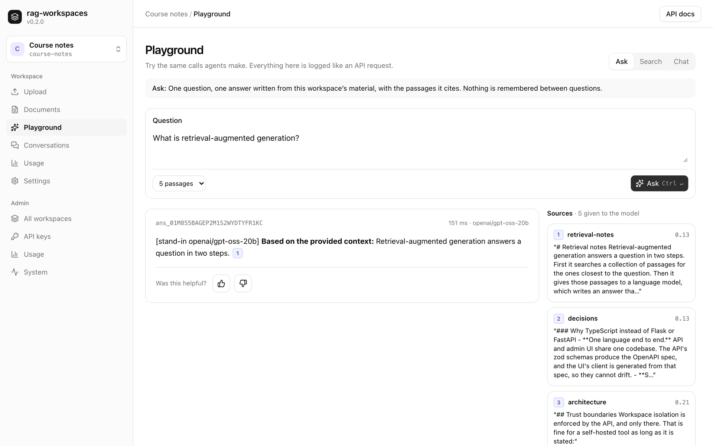
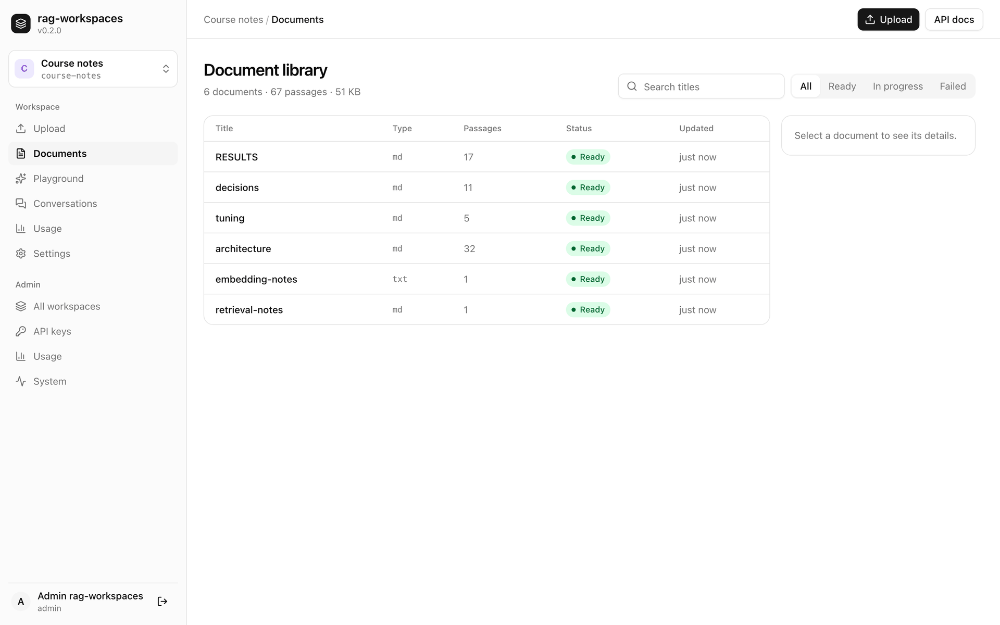
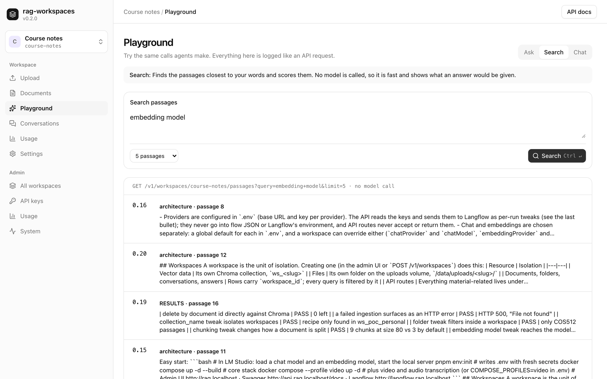
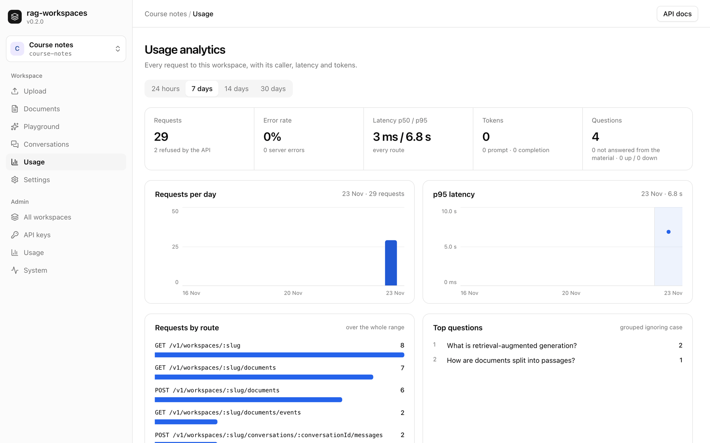
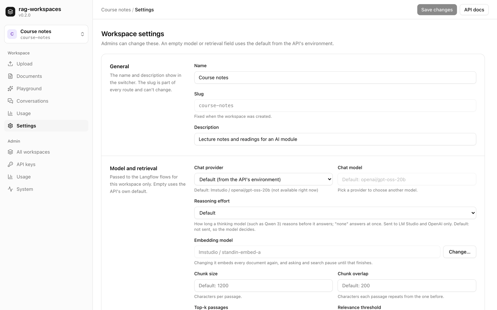
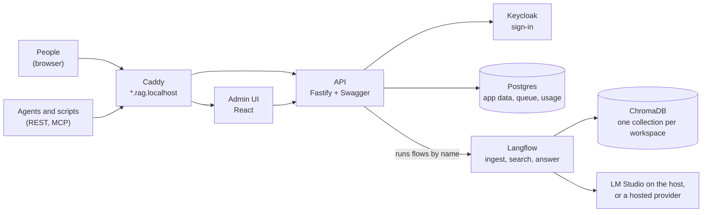

<div align="center">

# rag-workspaces

**Your own material, answered with citations, for people and AI agents.**

A self-hosted RAG platform built on Langflow. Load files into isolated **workspaces**, and each one gets an
admin UI, a documented REST API and an MCP server that answer from that material and cite where the
answer came from.

[](https://github.com/g-terra/rag-workspaces/actions/workflows/ci.yml)
[](https://github.com/g-terra/rag-workspaces/actions/workflows/smoke.yml)
[](https://github.com/g-terra/rag-workspaces/releases)
[](https://www.conventionalcommits.org)
<br>


[Quick start](#quick-start) · [User guide](docs/guide/README.md) · [API](docs/api.md) ·
[Architecture](docs/architecture.md) · [Contributing](CONTRIBUTING.md)

<picture>
  <source media="(prefers-color-scheme: dark)" srcset="docs/images/playground-answer-dark.png">
  
</picture>
<br><sub>The playground on a test stack with a stand-in model. With a real model, the answer is written from the cited passages.</sub>

</div>

## What it does

- **Workspaces keep material apart.** `ouc` for course material, `personal` for your notes: each has its own
  documents, vector index, settings, members and API, and nothing leaks between them.
- **Drop in files, or whole folders.** PDF, DOCX, TXT and Markdown, plus MP4, MP3 and WAV transcribed by
  Whisper. Each file is followed live through ingestion, and duplicates are skipped.
- **Import a documentation website.** Give a start URL and the site is crawled politely (robots.txt, sitemap,
  page and depth limits), each page becomes a document, and citations link back to the page. Crawl again to
  pick up what changed.
- **Answers that cite their sources.** Ask, search passages with their scores, or chat with follow-ups.
  Every answer streams in with numbered citations that point to the page, or the moment in a recording,
  in a response style you pick: academic, talkative, concise or tutor.
- **A real API for agents and scripts.** Resource-style REST routes with Swagger, workspace-scoped API keys
  (`reader` or `editor`), rate limits, and an MCP server for Claude Desktop, Claude Code and other clients.
- **Local first, hosted when you want.** Runs on LM Studio on your own machine by default; OpenAI, Gemini or
  Anthropic per workspace, with keys stored encrypted.
- **See how it's used.** Requests, latency, tokens, top questions, most cited documents, answer feedback and
  a full request log, per workspace or across all of them.
- **Accounts and roles.** Keycloak sign-in, a global admin role, and reader or editor access per workspace.
  Conversations are private to whoever asked.

<table>
  <tr>
    <td width="50%"><br><sub><b>Documents</b>: the library, with each file's status live</sub></td>
    <td width="50%"><br><sub><b>Search</b>: passages and their scores, no model call</sub></td>
  </tr>
  <tr>
    <td><br><sub><b>Usage</b>: requests, latency, top questions and cited documents</sub></td>
    <td><br><sub><b>Settings</b>: models, retrieval, provider keys and members</sub></td>
  </tr>
</table>

## Quick start

You need Docker with Compose, Node 22.18+ with pnpm 10 (`corepack enable`), about 6 GB of free memory for
the containers, and either [LM Studio](https://lmstudio.ai) or a key for OpenAI, Gemini or Anthropic.

```bash
git clone https://github.com/g-terra/rag-workspaces.git && cd rag-workspaces
pnpm install
pnpm run setup      # checks your machine, writes .env, picks the models, starts the stack
```

The setup wizard prints where to sign in when it's done. Your login is `RW_ADMIN_USERNAME` /
`RW_ADMIN_PASSWORD` from `.env`.

| Open | For |
|---|---|
| http://rag.localhost | The admin UI |
| http://api.rag.localhost/docs | The API and its Swagger UI |
| http://langflow.rag.localhost | The Langflow editor, where the flows live |
| http://auth.rag.localhost/admin | Keycloak's console, where you create people |

[Setup](docs/setup.md) explains each step, the `localhost` ports to use if those names don't open, updating
an existing install, and what to do when something goes wrong.

Then ask a workspace from a script:

```bash
curl -s http://api.rag.localhost/v1/workspaces/ouc/answers \
  -H "Authorization: Bearer rw_..." -H 'content-type: application/json' \
  -d '{ "question": "What is retrieval-augmented generation?" }'
```

## How it works



The API does the bookkeeping (who may do what, the ingest queue, conversations, usage) and leaves the AI
to Langflow. The AI work (loading, splitting, embedding, retrieval, prompting, generation) lives in
Langflow flows committed as JSON in `flows/`, which the API runs by name. [Architecture](docs/architecture.md)
has the full picture, and [Decisions](docs/decisions.md) the reasons behind each choice.

## Documentation

| | |
|---|---|
| [User guide](docs/guide/README.md) | Workspaces, uploads, the playground, API keys and agents, providers, usage, every setting |
| [Setup](docs/setup.md) | From a clone to a first answer, models, people, troubleshooting |
| [Using the API](docs/api.md) | Authentication and examples for scripts and agents |
| [Tuning answer quality](docs/tuning.md) | How answers were measured, and the settings that came out of it |
| [Architecture](docs/architecture.md) | Components, data flow, trust boundaries, repo layout |
| [API schema](docs/api-schema.md) | Every resource, route and shape |
| [Decisions](docs/decisions.md) | What is settled, and why |
| [Change specs](docs/specs/README.md) | One design record per pull request: how the system got here |
| [Contributing](CONTRIBUTING.md) | Dev setup, workflow, commits, releases, tests and PR rules |

## Background

rag-workspaces started as the project for the COS512 Langflow assignment at the Open University of Cyprus
(Option 4: expose AI interactions via an API), and `ouc` was its first workspace. The brief's example
endpoints map to these routes (no aliases, [decision 6](docs/decisions.md)):

| Brief | Route |
|---|---|
| `/ask` | `POST /v1/workspaces/{slug}/answers` |
| `/chat` | `POST /v1/workspaces/{slug}/conversations/{id}/messages` |
| `/retrieve` | `GET /v1/workspaces/{slug}/passages?query=…` |
| Usage analytics | `GET /v1/usage/…` and `GET /v1/workspaces/{slug}/usage/…` |

## Contributing

Issues and pull requests are welcome. [CONTRIBUTING.md](CONTRIBUTING.md) covers the dev setup, the
workflow every change follows, commit and release rules, the test suites and what a pull request needs.
