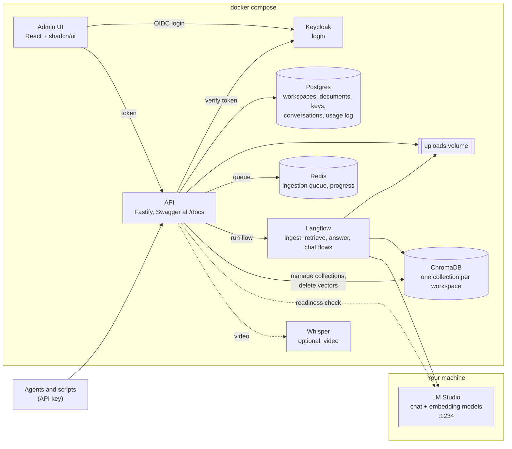
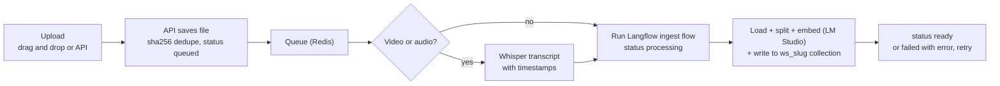

# Architecture

## Context

rag-workspaces is a general tool; its first use is the COS512 Langflow assignment, Option 4: expose AI interactions via an API. The brief asks for ask, chat and retrieve style endpoints, analytics on API usage, Langflow for the flow-based AI logic, a functional, interactive and tested system, and setup docs. Deliverables are the source code (including the Langflow flow JSON), a 3 to 5 page report and a 3 to 5 minute demo video. The brief suggests Flask or FastAPI; this project uses TypeScript, for the reasons in [decisions](decisions.md).

## Goals

1. One command to start everything: `docker compose up`.
2. **Workspaces:** any number of isolated groups of material, created at runtime. Each has its own vector collection, documents, conversations, API keys, analytics and optional model and prompt settings. Nothing leaks between workspaces through the API; see [trust boundaries](#trust-boundaries) for what that does and does not cover.
3. **Langflow does the AI work:** ingestion (load, split, embed, store) and answering (retrieve, prompt, generate) are Langflow flows committed as JSON in the repo.
4. A resource-oriented REST API documented with OpenAPI/Swagger ([schema](api-schema.md)).
5. Keycloak login for people, workspace-scoped API keys for agents and scripts.
6. Usage analytics per workspace, per key and per user.
7. Admin UI with drag-and-drop upload and live ingestion progress.
8. Provider-agnostic: LM Studio on the host by default, any OpenAI-compatible provider by config.
9. Tests at every layer, running in CI.
10. A submittable assignment early: the brief is fully covered once the API, flows, analytics, tests and docs exist (milestone M2 in the [work breakdown](work-breakdown.md)). The admin UI, video and the rest build on top and must not put the hand-in at risk.

## System overview



### Services (docker compose)

| Service | Image / source | Purpose |
|---|---|---|
| `api` | `apps/api` | Public REST API, Swagger docs, auth, workspace bookkeeping, ingestion queue consumer, analytics |
| `web` | `apps/admin` | Admin UI (static build served by nginx, proxies `/api`) |
| `langflow` | `langflowai/langflow` (pinned to an exact version) | Runs the ingest, retrieve, answer and chat flows; flow JSON in `flows/` is imported on startup. Flow JSON is tied to the Langflow version, so upgrades are deliberate and re-export the flows |
| `chroma` | `chromadb/chroma` (pinned, server mode) | Vector store; one collection per workspace |
| `keycloak` | `quay.io/keycloak/keycloak` (pinned) | Login; realm `rag-workspaces` imported from `docker/keycloak/realm.json` on first start |
| `postgres` | `postgres:16` | App data, plus separate databases for Langflow and Keycloak (created by an init script on first start) |
| `redis` | `redis:7` | Ingestion queue (BullMQ) and progress pub/sub |
| `whisper` | faster-whisper ASR web service | Video and audio transcription; compose profile `video`, off by default |

LM Studio is a desktop app on the host. Containers reach it at `http://host.docker.internal:1234/v1` (compose adds `extra_hosts: host.docker.internal:host-gateway` so this works on Linux too). The provider is a setting; any OpenAI-compatible endpoint works.

Published ports: only `web` (8080), `api` (3000), `keycloak` and `langflow` (7860) are published, all bound to `127.0.0.1` by default. `postgres`, `redis`, `chroma` and `whisper` are reachable only on the compose network. Every service has a healthcheck, and `api` waits for postgres, chroma, langflow and keycloak to be healthy before it starts.

Footprint: Keycloak and Langflow each want roughly 1 to 2 GB of RAM on top of the models LM Studio loads. `docs/setup.md` states a minimum (16 GB recommended) and which services can be left out.

Easy start:

```bash
# In LM Studio: load a chat model and an embedding model, start the local server
cp .env.example .env
docker compose up -d                   # core stack
docker compose --profile video up -d   # plus video transcription
# Admin UI http://localhost:8080 · Swagger http://localhost:3000/docs · Langflow http://localhost:7860
```

## Workspaces

A workspace is the unit of isolation. Creating one (in the admin UI or `POST /v1/workspaces`) does this:

| Resource | Isolation |
|---|---|
| Vector data | Its own Chroma collection, `ws_<slug>` |
| Files | Its own folder on the uploads volume, `/data/uploads/<slug>/` |
| Documents, folders, conversations, answers | Rows carry `workspace_id`; every query is filtered by it |
| API routes | Everything material-related lives under `/v1/workspaces/{slug}/...` |
| API keys | Each key is bound to one or more workspaces; a key for `personal` gets 404 on `ouc` |
| Analytics | Usage is logged with the workspace and can be viewed per workspace |
| Settings (optional) | Chat model, embedding model, system prompt, chunk size, top-k; empty means the global defaults |

Folders (for example a course code inside `ouc`) are optional groupings inside a workspace, usable as a filter when asking. They do not isolate anything.

The embedding model is fixed per workspace once it holds documents, because vectors from different models can't be compared. Changing it means re-indexing the workspace, which the API offers as one action.

## Who does what

- **Langflow does the AI work.** Four flows, all taking the workspace's settings as inputs (collection name, models, prompt, chunking), so one set of flows serves every workspace:
  - `flows/ingest.json`: load a file from the uploads volume, split it, embed with LM Studio, write to the workspace's Chroma collection with metadata (document id, folder, page or timestamp).
  - `flows/retrieve.json`: embed the query and return the best matching passages with scores and metadata, no generation. This backs the passages endpoint; without it the API would have to embed queries itself, which would put AI logic outside Langflow.
  - `flows/answer.json`: retrieve from the workspace's collection, build the prompt, generate an answer with citations.
  - `flows/chat.json`: the same, with conversation history. The flow is stateless: the API keeps the history in its `messages` table and sends the last turns with each run, so history lives in one place and deleting a conversation is one delete.
- **The API does the bookkeeping.** It saves uploads, deduplicates by checksum, keeps document records and statuses, queues ingestion and calls the ingest flow one file at a time, retries failures, creates and deletes Chroma collections, deletes a document's vectors by document id, updates passage metadata when a document moves folder, runs Whisper for video before ingestion, enforces auth and workspace isolation, logs usage, and shapes citations. Clients never call Langflow or Chroma directly.

### The flow contract

The API and the flows meet at a small, tested contract, because this is the part of the design most likely to break quietly:

- **Run by name, not id.** Each flow has a fixed endpoint name (`rw-ingest`, `rw-retrieve`, `rw-answer`, `rw-chat`). Flow ids change on import; names do not.
- **Inputs are tweaks on named components.** The API passes collection name, embedding model, chat model, system prompt, chunk size and overlap, top-k, folder filter and document id as tweaks. The component names the API relies on are listed in `flows/README.md`, and a CI test fails if a committed flow no longer has them.
- **Outputs are structured.** `rw-retrieve`, `rw-answer` and `rw-chat` return the retrieved passages as data (passage id, document id, chunk index, page or start seconds, text, score) next to the answer text. Citations are the passages that were given to the model; the API does not guess which ones the model used.
- **Passage metadata is written at ingestion:** `document_id`, `folder_id`, `chunk_index`, and `page` or `start_seconds`. The passage id is `psg_<document ulid>_<chunk index>`, so neighbours are found without a second index and re-ingestion is repeatable.
- **Small custom components are expected.** Stock Langflow components load a file as one text and do not keep page numbers, chunk indexes or transcript timestamps. Where needed, the flows carry small custom components (Python inside the flow JSON). The project still has no Python service.
- **Grounding.** The answer prompt tells the model to answer only from the passages and to say so when they do not contain the answer. If retrieval returns nothing above the workspace's minimum score, the API returns that "not found" answer with empty citations without calling the chat model.
- **Flows live in git.** `pnpm flows:export` pulls the flows out of the running Langflow into `flows/` (without saved credentials), `pnpm flows:import` pushes them in. Editing in the Langflow editor and forgetting to export is the usual way the repo and the running system drift.

All of this is unproven until the [M0 spike](work-breakdown.md#m0-spike-prove-the-langflow-contract) has run.

## Ingestion



- Statuses per document: `queued`, `transcribing` (video only), `processing`, `ready`, `failed`. The admin UI shows them live over server-sent events.
- Re-uploading an identical file in the same workspace is a no-op. Re-indexing a document deletes its vectors by `document_id` and runs the flow again.
- Progress is per file, not per chunk, because the flow runs as one step. That is the trade for keeping all AI logic in Langflow.

Rules that keep ingestion honest when things fail:

- **Every attempt starts clean.** Before running the flow, the worker deletes any vectors already stored for the document, so a retry after a half-finished run cannot leave duplicates.
- **Timeouts and retries.** A flow run has a timeout scaled by file size. Failures retry up to 3 times with backoff; after that the document is `failed` with the error text and a manual retry button.
- **One file at a time across the whole install** by default (configurable). LM Studio is one local model server, so running workspaces in parallel only makes each file slower.
- **Recovery on start.** Documents left in `transcribing` or `processing` by a crash are put back to `queued` when the API starts.
- **Limits at the door.** Maximum file size (default 200 MB, 2 GB with the video profile), allowed types checked by content and not only by extension, and a clear `failed` reason for scanned PDFs with no text layer (OCR is out of scope).
- **Postgres is the source of truth.** A document is searchable only when its row is `ready`. A `pnpm doctor` command compares rows, files on the volume and vectors in Chroma and reports orphans.
- **Changing the embedding model** means a new vector size, so workspace reindex drops and recreates the collection. The workspace shows `reindexing` and search returns 503 until it finishes.

## Auth

- **People** sign in to the admin UI through Keycloak (OIDC authorization code with PKCE). Accounts are created by admins only, in Keycloak's own admin console; self-registration is off. Our admin UI lists people read-only and grants them workspace access. There is one realm role, `admin` (manage everything). Everyone else gets access per workspace.
- **Workspace roles** are the same two words for people and keys: `reader` (ask, chat, search) and `editor` (also upload and delete documents, see the workspace's usage). Admins grant a person a role in a workspace; the grant is stored against their Keycloak user id.
- **API keys** are created by admins only, in the admin UI. Each key is bound to one or more workspaces and has one role, `reader` or `editor`. The secret is 32 random bytes with an `rw_` prefix, shown once and stored as a SHA-256 hash (enough for a high-entropy secret, and fast to look up). Keys can expire, can be revoked, and record when they were last used.
- **The API** accepts `Authorization: Bearer <token or key>`. Anything starting with `rw_` is looked up as an API key; anything else must be a JWT verified against Keycloak's JWKS (issuer, audience, expiry).
- **Issuer URL.** The browser reaches Keycloak at `localhost`, the API reaches it at `keycloak:8080`, and tokens carry the browser's URL as issuer. Keycloak gets a fixed public hostname, and the API fetches keys from the internal URL while checking the issuer against the public one. This is a common first-day failure, so the compose smoke test logs in for real.
- **Streaming and auth.** The browser's `EventSource` cannot send an `Authorization` header, so the admin UI reads server-sent events with `fetch`.
- **Rate limits.** Per key and per user, with `429` and `Retry-After`. Generous defaults; the point is that a looping agent cannot starve the one local model.

## Trust boundaries

Workspace isolation is enforced by the API, and only there. That is fine for a self-hosted tool as long as it is stated:

- **Langflow's editor sees everything.** Anyone who can sign in to Langflow can read every collection and the uploads volume. It is an admin tool: auto-login is off, the superuser comes from `.env`, and the port is bound to localhost.
- **Chroma, Postgres and Redis have no per-workspace access control** and are not published outside the compose network.
- **The API chooses the collection.** Flows receive the collection name from the API and never from the caller, so a request cannot name another workspace's collection. The isolation tests cover every route.
- **Documents are untrusted text.** A file can contain instructions aimed at the model. The system prompt separates passages from instructions, and the flows have no tools that could act on them; this limits the damage to a wrong answer in that workspace.
- **Questions are stored.** The usage log keeps question text for analytics. A retention setting (default 90 days) trims it, and `docs/operations.md` says so.
- **Secrets** live in `.env` only. `.env.example` has no working defaults for passwords, and the API refuses to start with the placeholder values.

## Operations

Small, but written down so the system can be trusted with real notes:

- **Data lives in four named volumes:** postgres, chroma, uploads, and Langflow's config. `pnpm backup` and `pnpm restore` dump and load all of them together, because a Postgres backup without the matching Chroma data is not a working backup.
- **Readiness.** `/ready` reports ok or not; an admin-only `GET /v1/system` says which dependency is failing: Postgres, Chroma, Langflow (flows present), Keycloak, and the model provider (reachable, and the configured chat and embedding models are available). The usual failure is LM Studio not running or the model not loaded, so the admin UI shows it as a banner.
- **Logs.** Structured JSON logs with the request id, which is also passed to Langflow runs so one question can be followed across both.
- **Migrations** run on API start; upgrades are `git pull` and `docker compose up -d --build`, with a note in `docs/operations.md` for Langflow version bumps.

## Repository layout (Turborepo + pnpm workspaces)

```
apps/
  api/            Fastify + zod + Swagger; routes, auth, workspace isolation, ingestion queue, analytics
  admin/          Vite + React + Tailwind + shadcn/ui
packages/
  shared/         zod schemas and types shared by api and admin (the API contract)
  db/             Drizzle schema + migrations
  langflow-client/ typed client for Langflow's run API
  config/         shared tsconfig, eslint, prettier, vitest presets
flows/            ingest.json, retrieve.json, answer.json, chat.json, README.md (the flow contract)
scripts/          flows export/import, backup/restore, doctor
docker/           Dockerfiles, nginx config, keycloak/realm.json
docs/
tests/            e2e (Playwright, compose smoke), eval (golden questions, run locally), fixtures, stub model server
docker-compose.yml, turbo.json, pnpm-workspace.yaml, .env.example
```

## Tech choices at a glance

| Area | Choice |
|---|---|
| Language / runtime | TypeScript, Node 22 LTS |
| Monorepo | Turborepo + pnpm workspaces |
| API | Fastify, zod (`fastify-type-provider-zod`), `@fastify/swagger` + `@fastify/swagger-ui`, `@fastify/multipart` |
| AI flows | Langflow (ingest, retrieve, answer, chat), flow JSON versioned in `flows/` |
| Vector DB | ChromaDB, one collection per workspace |
| Models | LM Studio on the host by default (OpenAI-compatible); configurable per workspace |
| Auth | Keycloak (OIDC) for people, hashed API keys for agents, `@fastify/rate-limit` |
| Queue | BullMQ on Redis |
| App DB | Postgres + Drizzle ORM |
| Transcription | faster-whisper ASR service + ffmpeg (optional profile) |
| Admin UI | Vite + React, Tailwind CSS, shadcn/ui, TanStack Query, react-dropzone, oidc-client-ts, fetch-based SSE |
| Tests | Vitest, Testcontainers, Playwright, MSW |
| CI | GitHub Actions |
