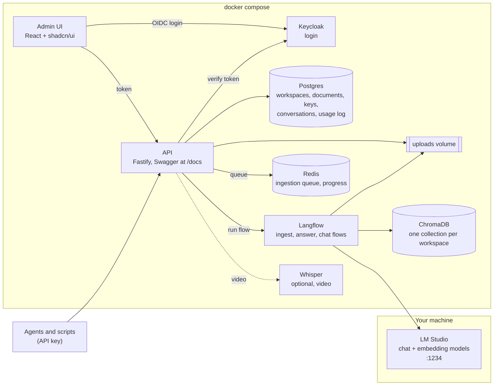
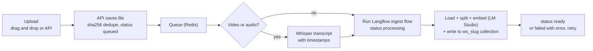

# Architecture

## Context

rag-workspaces is a general tool; its first use is the COS512 Langflow assignment, Option 4: expose AI interactions via an API. The brief asks for ask, chat and retrieve style endpoints, analytics on API usage, Langflow for the flow-based AI logic, a functional, interactive and tested system, and setup docs. Deliverables are the source code (including the Langflow flow JSON), a 3 to 5 page report and a 3 to 5 minute demo video. The brief suggests Flask or FastAPI; this project uses TypeScript, for the reasons in [decisions](decisions.md).

## Goals

1. One command to start everything: `docker compose up`.
2. **Workspaces:** any number of isolated groups of material, created at runtime. Each has its own vector collection, documents, conversations, API keys, analytics and optional model and prompt settings. Nothing leaks between workspaces.
3. **Langflow does the AI work:** ingestion (load, split, embed, store) and answering (retrieve, prompt, generate) are Langflow flows committed as JSON in the repo.
4. A resource-oriented REST API documented with OpenAPI/Swagger ([schema](api-schema.md)).
5. Keycloak login for people, workspace-scoped API keys for agents and scripts.
6. Usage analytics per workspace, per key and per user.
7. Admin UI with drag-and-drop upload and live ingestion progress.
8. Provider-agnostic: LM Studio on the host by default, any OpenAI-compatible provider by config.
9. Tests at every layer, running in CI.

## System overview



### Services (docker compose)

| Service | Image / source | Purpose |
|---|---|---|
| `api` | `apps/api` | Public REST API, Swagger docs, auth, workspace bookkeeping, ingestion queue consumer, analytics |
| `web` | `apps/admin` | Admin UI (static build served by nginx, proxies `/api`) |
| `langflow` | `langflowai/langflow` (pinned) | Runs the ingest, answer and chat flows; flow JSON in `flows/` is imported on startup |
| `chroma` | `chromadb/chroma` (pinned, server mode) | Vector store; one collection per workspace |
| `keycloak` | `quay.io/keycloak/keycloak` (pinned) | Login; realm `rag-workspaces` imported from `docker/keycloak/realm.json` on first start |
| `postgres` | `postgres:16` | App data, plus separate databases for Langflow and Keycloak |
| `redis` | `redis:7` | Ingestion queue (BullMQ) and progress pub/sub |
| `whisper` | faster-whisper ASR web service | Video and audio transcription; compose profile `video`, off by default |

LM Studio is a desktop app on the host. Containers reach it at `http://host.docker.internal:1234/v1` (compose adds `extra_hosts: host.docker.internal:host-gateway` so this works on Linux too). The provider is a setting; any OpenAI-compatible endpoint works.

Easy start:

```bash
# In LM Studio: load a chat model and an embedding model, start the local server
cp .env.example .env
docker compose up -d                   # core stack
docker compose --profile video up -d   # plus video transcription
# Admin UI http://localhost:8080 · Swagger http://localhost:3000/docs · Langflow http://localhost:7860
```

## Workspaces

A workspace is the unit of isolation. Creating one (in the admin UI or `POST /v1/workspaces`) does this:

| Resource | Isolation |
|---|---|
| Vector data | Its own Chroma collection, `ws_<slug>` |
| Files | Its own folder on the uploads volume, `/data/uploads/<slug>/` |
| Documents, folders, conversations, answers | Rows carry `workspace_id`; every query is filtered by it |
| API routes | Everything material-related lives under `/v1/workspaces/{slug}/...` |
| API keys | Each key is bound to one or more workspaces; a key for `personal` gets 404 on `ouc` |
| Analytics | Usage is logged with the workspace and can be viewed per workspace |
| Settings (optional) | Chat model, embedding model, system prompt, chunk size, top-k; empty means the global defaults |

Folders (for example a course code inside `ouc`) are optional groupings inside a workspace, usable as a filter when asking. They do not isolate anything.

The embedding model is fixed per workspace once it holds documents, because vectors from different models can't be compared. Changing it means re-indexing the workspace, which the API offers as one action.

## Who does what

- **Langflow does the AI work.** Three flows, all taking the workspace's settings as inputs (collection name, models, prompt, chunking), so one set of flows serves every workspace:
  - `flows/ingest.json`: load a file from the uploads volume, split it, embed with LM Studio, write to the workspace's Chroma collection with metadata (document id, folder, page or timestamp).
  - `flows/answer.json`: retrieve from the workspace's collection, build the prompt, generate an answer with citations.
  - `flows/chat.json`: the same, with conversation memory keyed by conversation id.
- **The API does the bookkeeping.** It saves uploads, deduplicates by checksum, keeps document records and statuses, queues ingestion and calls the ingest flow one file at a time, retries failures, deletes a document's vectors by document id, runs Whisper for video before ingestion, enforces auth and workspace isolation, logs usage, and shapes citations. Clients never call Langflow or Chroma directly.

## Ingestion



- Statuses per document: `queued`, `transcribing` (video only), `processing`, `ready`, `failed`. The admin UI shows them live over server-sent events.
- Re-uploading an identical file in the same workspace is a no-op. Re-indexing a document deletes its vectors by `document_id` and runs the flow again.
- Progress is per file, not per chunk, because the flow runs as one step. That is the trade for keeping all AI logic in Langflow.

## Auth

- **People** sign in to the admin UI through Keycloak (OIDC authorization code with PKCE). Accounts are created by admins only; self-registration is off. Realm roles: `admin` (manage everything) and `member` (use workspaces they are granted).
- **API keys** are created by admins only, in the admin UI. Each key is bound to one or more workspaces and has a role, `reader` (ask, chat, search) or `editor` (also upload and delete documents). The secret is shown once and stored hashed.
- **The API** accepts `Authorization: Bearer <token or key>`. A JWT is verified against Keycloak's JWKS (issuer, audience, expiry); anything else is looked up as an API key.

## Repository layout (Turborepo + pnpm workspaces)

```
apps/
  api/            Fastify + zod + Swagger; routes, auth, workspace isolation, ingestion queue, analytics
  admin/          Vite + React + Tailwind + shadcn/ui
packages/
  shared/         zod schemas and types shared by api and admin (the API contract)
  db/             Drizzle schema + migrations
  langflow-client/ typed client for Langflow's run API
  config/         shared tsconfig, eslint, prettier, vitest presets
flows/            ingest.json, answer.json, chat.json (imported into Langflow at startup)
docker/           Dockerfiles, nginx config, keycloak/realm.json
docs/
tests/            e2e (Playwright, compose smoke), eval (golden questions), fixtures
docker-compose.yml, turbo.json, pnpm-workspace.yaml, .env.example
```

## Tech choices at a glance

| Area | Choice |
|---|---|
| Language / runtime | TypeScript, Node 22 LTS |
| Monorepo | Turborepo + pnpm workspaces |
| API | Fastify, zod (`fastify-type-provider-zod`), `@fastify/swagger` + `@fastify/swagger-ui`, `@fastify/multipart` |
| AI flows | Langflow (ingest, answer, chat), flow JSON versioned in `flows/` |
| Vector DB | ChromaDB, one collection per workspace |
| Models | LM Studio on the host by default (OpenAI-compatible); configurable per workspace |
| Auth | Keycloak (OIDC) for people, hashed API keys for agents |
| Queue | BullMQ on Redis |
| App DB | Postgres + Drizzle ORM |
| Transcription | faster-whisper ASR service + ffmpeg (optional profile) |
| Admin UI | Vite + React, Tailwind CSS, shadcn/ui, TanStack Query, react-dropzone, oidc-client-ts |
| Tests | Vitest, Testcontainers, Playwright, MSW |
| CI | GitHub Actions |
