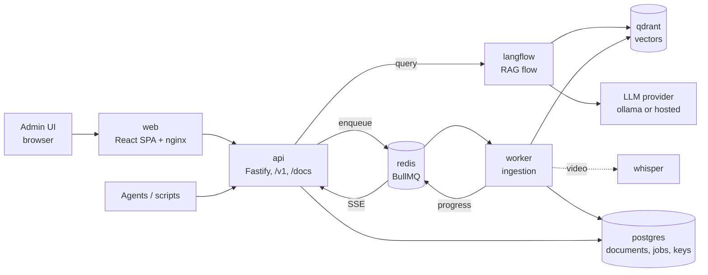

# Architecture

## Goals

1. One command to start everything locally: `docker compose up` (or `pnpm dev` for development).
2. A REST API, documented with OpenAPI/Swagger, that answers questions over the indexed material with citations, for both humans and agents.
3. A documented ingestion pipeline for PDF, DOCX, TXT and MD, with an optional video path (Whisper transcription).
4. An admin UI with drag-and-drop upload and live ingestion progress.
5. Provider-agnostic: the LLM and embedding provider are configuration, and the default setup runs fully locally.
6. Tests at every layer, running in CI on every pull request.

## System overview



### Services (docker compose)

| Service | Image / source | Purpose |
|---|---|---|
| `api` | `apps/api` | Public REST API, OpenAPI docs, uploads, SSE progress, auth |
| `worker` | `apps/worker` | Runs ingestion jobs: parse, chunk, embed, upsert, report progress |
| `web` | `apps/admin` | Admin UI (static build served by nginx, proxies `/api` to `api`) |
| `langflow` | `langflowai/langflow` (pinned) | Hosts the retrieval + answer flow; flows are versioned in `flows/` and auto-loaded |
| `qdrant` | `qdrant/qdrant` (pinned) | Vector store |
| `postgres` | `postgres:16` | Document and job metadata, API keys; also Langflow's own database (separate schema/db) |
| `redis` | `redis:7` | BullMQ job queue and progress pub/sub |
| `whisper` | faster-whisper ASR web service | Video/audio transcription. Compose profile `video`, off by default |
| `ollama` | `ollama/ollama` | Local LLM + embeddings. Compose profile `local-llm`; skip it when using a hosted provider |

Easy start:

```bash
cp .env.example .env            # choose provider, set keys if hosted
docker compose up -d            # core stack
docker compose --profile video --profile local-llm up -d   # everything, fully local
pnpm ingest ./materials         # optional: bulk-load a folder from the CLI
open http://localhost:8080      # admin UI;  http://localhost:3000/docs for Swagger
```

## Responsibilities: who does what

The key design choice is the split between our TypeScript code and Langflow:

- **Our code owns ingestion.** The worker parses, chunks, embeds and writes to Qdrant. This gives us per-file, per-stage progress, deterministic behaviour we can unit-test, and helper scripts that work without the UI.
- **Langflow owns the query flow.** A versioned flow (`flows/rag-query.json`) does retrieval from the same Qdrant collection with the same embedding model, builds the prompt, and calls the LLM. Changing prompts, rerankers or models is done in Langflow's editor, then the exported flow is committed.
- **The API is the only public surface.** Clients never call Langflow or Qdrant directly. The API adds auth, validation, OpenAPI docs, citations shaping, and a stable contract even when the flow changes.

The embedding model must match between the worker and the Langflow flow. It is set once in `.env` (`EMBEDDING_PROVIDER`, `EMBEDDING_MODEL`) and the API refuses to start if the collection's recorded model differs.

## Ingestion pipeline

```
upload / CLI ──► store file (volume ./data/uploads, sha256 dedupe)
             ──► create Document + Job (postgres) ──► enqueue (BullMQ)
worker:  detect type ──► extract text ──► normalise ──► chunk ──► embed (batched) ──► upsert Qdrant ──► done
           │               │
           │               ├─ pdf:  unpdf (pdf.js), page numbers kept for citations
           │               ├─ docx: mammoth → markdown, headings kept
           │               ├─ md / txt: as is (front-matter parsed into metadata)
           │               └─ video/audio: ffmpeg → whisper → timestamped transcript (profile "video")
           └─ each stage emits progress events → redis pub/sub → API SSE → admin UI
```

- **Chunking:** heading-aware recursive splitter, default ~800 tokens with ~100 overlap, configurable. Each chunk carries `documentId`, `course`, `title`, `source path`, `page` or `timestamp`, `heading path`, `chunkIndex`.
- **Idempotency:** files are keyed by sha256. Re-uploading the same file is a no-op; re-ingesting (e.g. after a chunking change) deletes the document's old points first.
- **Collections:** material is tagged by `course` (e.g. a module code) so queries can filter by course. One Qdrant collection, course as a payload filter.
- **Failures:** jobs retry with backoff; a failed stage is visible in the UI with the error and a retry button.
- **Helper scripts** (`packages/cli`, exposed as `pnpm ingest`, `pnpm parse`, `pnpm reindex`): bulk-load a folder, dry-run parse a file and print chunks, reindex everything. They call the same `ingestion-core` package the worker uses, so behaviour is identical.

## API surface (v1)

All routes are under `/v1`, validated with zod, and documented at `/docs` (Swagger UI) and `/openapi.json`.

| Method | Path | Purpose |
|---|---|---|
| `POST` | `/v1/query` | Ask a question. Body: `question`, optional `course`, `topK`. Returns `answer` + `citations[]` (document, page/timestamp, snippet). Supports `stream=true` (SSE) |
| `POST` | `/v1/search` | Retrieval only: top-k chunks with scores, no LLM. Useful for agents that do their own reasoning |
| `POST` | `/v1/documents` | Multipart upload of one or more files (+ `course`, tags). Returns created documents and job ids |
| `GET` | `/v1/documents` | List with filters (course, status, type), pagination |
| `GET` | `/v1/documents/{id}` | Detail, including chunk count and job history |
| `GET` | `/v1/documents/{id}/chunks` | Inspect stored chunks (debugging retrieval) |
| `DELETE` | `/v1/documents/{id}` | Remove file, metadata and vectors |
| `POST` | `/v1/documents/{id}/reindex` | Re-run ingestion |
| `GET` | `/v1/jobs` / `/v1/jobs/{id}` | Job status and per-stage progress |
| `GET` | `/v1/jobs/events` | SSE stream of progress events for the admin UI |
| `GET` | `/v1/courses` | Courses with document counts |
| `GET` | `/health`, `/ready` | Liveness and dependency readiness (postgres, redis, qdrant, langflow) |

**Auth:** API keys (`Authorization: Bearer <key>`) with two scopes, `read` (query/search) and `admin` (upload, delete). A bootstrap admin key comes from `.env`. Keys are hashed in Postgres.

**Agents:** besides REST, a later milestone adds an MCP server (`apps/mcp`) exposing `search_materials` and `ask_materials` tools that call the same API, so Claude and other agents can use the material directly.

## Repository layout (Turborepo + pnpm workspaces)

```
apps/
  api/            Fastify + zod + @fastify/swagger; routes, auth, SSE
  worker/         BullMQ consumer running the ingestion pipeline
  admin/          Vite + React + Tailwind + shadcn/ui admin UI
  mcp/            (later) MCP server for agents
packages/
  shared/         zod schemas and types shared by api, worker, admin (single source of the API contract)
  ingestion-core/ parsers, chunker, embedder adapters, Qdrant writer
  langflow-client/ typed client for the Langflow run API
  db/             Drizzle schema + migrations (documents, jobs, api_keys)
  cli/            helper scripts: ingest, parse, reindex
  config/         shared tsconfig, eslint, prettier, vitest presets
flows/            exported Langflow flows (auto-loaded at startup)
docker/           Dockerfiles, nginx config
docs/             these documents, plus ingestion guide and API guide
tests/
  e2e/            Playwright (admin) + compose smoke tests
  eval/           golden questions for retrieval quality
docker-compose.yml, turbo.json, pnpm-workspace.yaml, .env.example
```

## Tech choices at a glance

| Area | Choice |
|---|---|
| Language / runtime | TypeScript, Node 22 LTS |
| Monorepo | Turborepo + pnpm workspaces |
| API | Fastify, zod (`fastify-type-provider-zod`), `@fastify/swagger` + `@fastify/swagger-ui`, `@fastify/multipart` |
| Queue | BullMQ on Redis |
| Metadata DB | Postgres + Drizzle ORM |
| Vector DB | Qdrant (see [decisions](decisions.md)) |
| RAG orchestration | Langflow, flows versioned in `flows/` |
| LLM / embeddings | Configurable; default Ollama (local), OpenAI-compatible and Anthropic supported |
| Transcription | faster-whisper ASR service + ffmpeg (optional profile) |
| Admin UI | Vite + React, Tailwind CSS, shadcn/ui, TanStack Query, react-dropzone |
| Tests | Vitest, Testcontainers, Playwright, MSW |
| CI | GitHub Actions |
