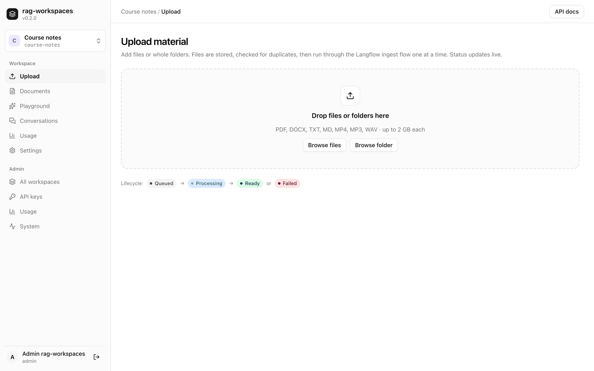
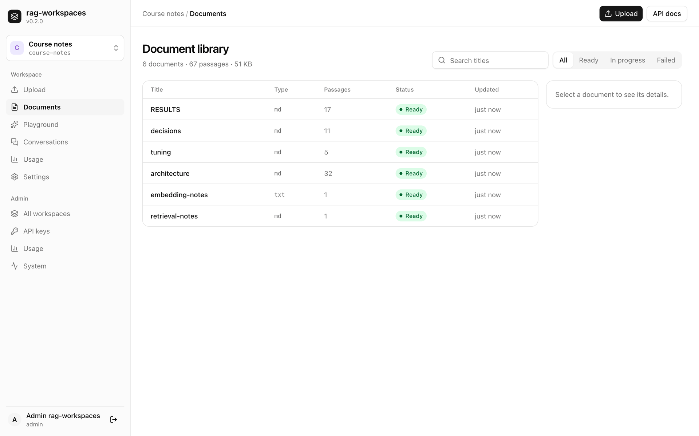

# Adding material

Editors and admins add files to a workspace; the system splits them into passages, embeds them and indexes
them, so they can be searched and cited.

## Upload

"Upload" in the sidebar takes files by drag and drop or the file picker: PDF, DOCX, TXT and Markdown, plus
MP4, MP3 and WAV when video and audio are turned on (below). Up to 20 files at a time, each up to
`MAX_UPLOAD_BYTES` (2 GB by default).



To upload a whole folder, drop it on the page or use **Browse folder**. Every file in it and its
subfolders is uploaded, each row showing its path inside the folder (`COS512/Week 1/intro.pdf`). Files the
platform can't read (`.pptx`, `.zip` and so on) are skipped with one summary line, and hidden files such as
`.DS_Store` are ignored. The files land at the top level of the workspace.

Each file shows its progress live as it moves through ingestion:

| Status | Means |
|---|---|
| `queued` | Uploaded and waiting for a worker |
| `transcribing` | A recording is being turned into text by Whisper |
| `processing` | Being split, embedded and written to the index |
| `ready` | Searchable and citable |
| `failed` | Something went wrong; the reason is shown, and "Retry" runs it again |

A file whose contents are already in the workspace isn't ingested twice: the upload returns the existing
document and says it is a duplicate.

Through the API: `POST /v1/workspaces/{slug}/documents` with multipart `files` parts
([Using the API](../api.md#add-material-editor)).

Folders inside a workspace (for example one per course) exist in the API so far: `POST …/folders`, then
upload with `?folderId=` ([Using the API](../api.md#add-material-editor)).

## Documents

"Documents" lists everything in the workspace, live, with each document's type, number of passages, status and when it
last changed. Everyone with access can preview and download a document: a PDF opens in a viewer inside
the app (from an answer's citation, on the cited page), and a recording shows its transcript with the time
each line starts. Editors and admins can also
reindex or delete one.



## Import a documentation website

Give a workspace the start URL of a documentation website and it is crawled politely: same host, under the
start URL's path, robots.txt and the sitemap honoured, one request a second, within page and depth limits.
Each page becomes a document of type `web`, turned into clean Markdown without the navigation, and its
passages and citations carry the page's address (`sourceUrl`), so an answer links straight to the page.
Crawling again refreshes changed pages, adds new ones and removes pages that are gone.

So far this is in the API (editors and admins); a page for it in the admin UI is in review
([#121](https://github.com/g-terra/rag-workspaces/pull/121)).

```bash
curl -s http://api.rag.localhost/v1/workspaces/ouc/sites -H "Authorization: Bearer rw_..." \
  -H 'content-type: application/json' \
  -d '{ "url": "https://docs.example.com/guide/", "maxPages": 50, "excludePaths": ["/guide/fr/"] }'
```

`GET …/sites/{siteId}` shows its status and counters, `POST …/sites/{siteId}/crawl` crawls it again,
`PATCH` changes its limits or folder, and `DELETE` removes it with all its pages. Start with a small
`maxPages` to check the result: a large site takes a while. Sites that need JavaScript or a login aren't
supported, and private addresses are refused unless listed in `CRAWL_ALLOWED_HOSTS`
([Setup](../setup.md#documentation-websites) has the details).

## Video and audio

MP4, MP3 and WAV files are transcribed by Whisper first, and the transcript is what gets searched. Sources
in answers then say `at 12:34` instead of a page. It is off by default, because the image is about 1 GB
and transcribing runs on the CPU. `pnpm run setup` offers to turn it on; [Setup](../setup.md#video-and-audio)
has the details and the `.env` lines.

Without it, video and audio uploads are refused with a message saying how to turn it on.

## Tips

- Text-based PDFs work best. A scanned PDF with no text layer gives no passages.
- For a long lecture video, uploading just the audio is much quicker:
  `ffmpeg -i lecture.mp4 -vn -c:a libmp3lame -b:a 64k lecture.mp3`.
- If documents fail with an embedding error, the embedding model isn't reachable. Check
  [Models and providers](providers.md), then retry them.
