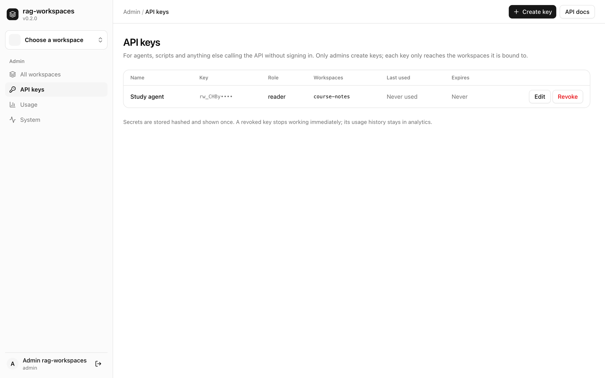

# API keys and agents

Scripts and AI agents use the same API as the admin UI, with an API key instead of a person's login.
Only admins create keys, and each key is limited to the workspaces it names.

## Create a key (admins)

"API keys" in the sidebar lists every key with its role, workspaces, prefix, when it was last used and
when it expires. "New key" asks for:

- **Name**: who or what uses it, for example "Study agent".
- **Role**: `reader` (search, ask, chat) or `editor` (also upload, reindex and delete documents). A key's
  role can't change later; make a new key instead.
- **Workspaces**: the ones it may use. Any other workspace answers `404` to it, as if it didn't exist.
- **Expiry**: optional.



The secret (`rw_…`) is shown **once**, with a `curl` example to try it. Copy it then; only its prefix is
kept. Revoking a key stops it at once; it stays listed with the date it was revoked.

Through the API: `POST /v1/api-keys { "name": "…", "role": "reader", "workspaces": ["ouc"] }`.

## Use it from a script

Send it as a bearer token:

```bash
curl -s http://api.rag.localhost/v1/workspaces/ouc/answers \
  -H "Authorization: Bearer rw_..." -H 'content-type: application/json' \
  -d '{ "question": "What is retrieval-augmented generation?" }'
```

[Using the API](../api.md) has examples for search, streaming, chat and uploads, from the shell and from
code. Each key counts toward the rate limits (`RATE_LIMIT_PER_MINUTE` and `RATE_LIMIT_MODEL_PER_MINUTE`,
see [Configuration](configuration.md)), and its requests show in [Usage analytics](usage.md).

## Connect an AI agent (MCP)

`apps/mcp` is an [MCP](https://modelcontextprotocol.io) server, so Claude Desktop, Claude Code or any MCP
client can search and ask a workspace. It runs on your machine and calls the REST API with an API key, so
the key's role and workspaces decide what the agent sees.

| Tool | What it does |
|---|---|
| `list_workspaces` | The workspaces the key can use |
| `list_folders`, `list_documents` | What is in one |
| `search_passages` | Passages with scores, no model call |
| `read_passage` | One passage in full |
| `list_styles` | The response styles `ask` can use |
| `ask` | An answer with citations, in an optional `style` (`null` for none) |

None of them change any material.

1. Create a `reader` key for the workspaces the agent may use.
2. Build the server once: `pnpm install && pnpm --filter '@rag/mcp...' build`.
3. Add it to your client. Claude Code:

   ```bash
   claude mcp add rag-workspaces --env RW_API_KEY=rw_... --env RW_API_URL=http://localhost:3000 \
     -- node "$PWD/apps/mcp/dist/main.js"
   ```

   Claude Desktop (`claude_desktop_config.json`, with the full path to your clone):

   ```json
   {
     "mcpServers": {
       "rag-workspaces": {
         "command": "node",
         "args": ["/path/to/rag-workspaces/apps/mcp/dist/main.js"],
         "env": { "RW_API_KEY": "rw_...", "RW_API_URL": "http://localhost:3000" }
       }
     }
   }
   ```

`RW_API_URL` defaults to `http://localhost:3000`; `http://api.rag.localhost` works too. An API error (a
wrong workspace, a `429`) comes back to the agent as a tool error with the API's reason.
