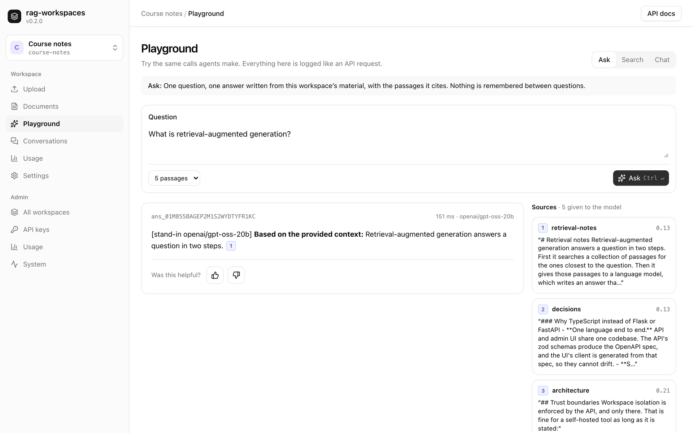
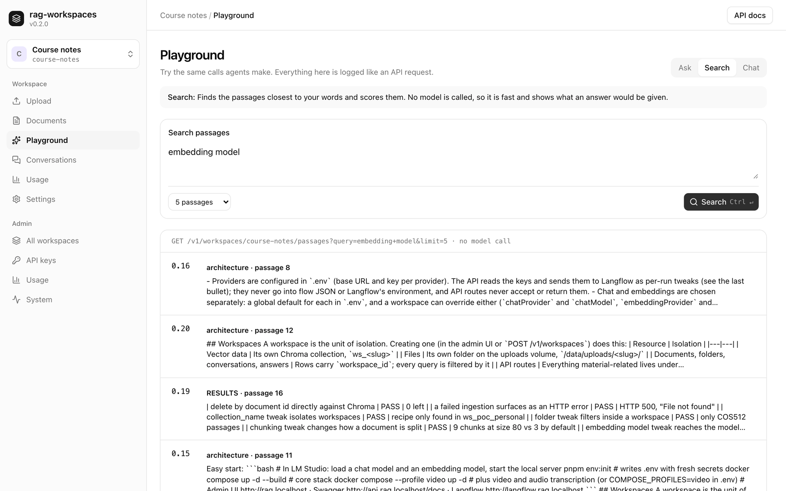
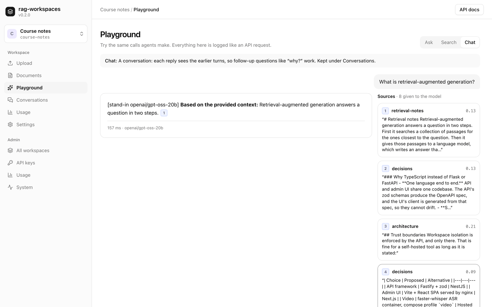
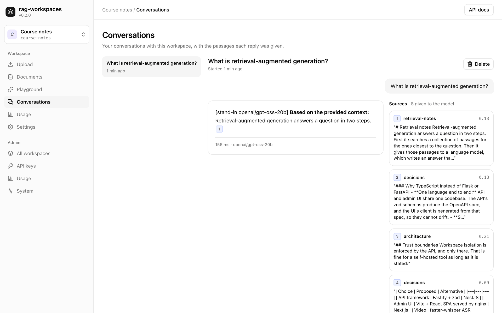

# Playground and conversations

The playground is where you try a workspace the way an agent would use it through the API. It has three
modes, picked at the top of the page (the mode is in the URL, so a link opens the same one).

## Ask

One question, one answer written from the workspace's material. The answer streams in word by word, with
numbered citations like `[1]` that point to the passages it used. Each source shows its document and page
(or `at 12:34` for a recording) and opens the document there. Nothing is remembered between questions.

Under each answer, thumbs up or down records whether it helped, with an optional comment on a thumbs down.
Admins see that feedback in [Usage analytics](usage.md).

If no passage scores above the workspace's relevance threshold, the answer says the material doesn't cover
the question instead of guessing ([Workspaces](workspaces.md#settings-admins)).

Through the API: `POST /v1/workspaces/{slug}/answers { "question": "…" }`, or with
`Accept: text/event-stream` to stream it ([Using the API](../api.md#search-ask-and-chat-reader)).

## Search

Finds the passages closest to your words and shows each with its score (0 to 1). No model is called, so it
is fast, and it shows exactly what an answer would be given. Use it to see why an answer missed something:
if the right passage isn't here, no prompt change will fix it; look at chunk size, the embedding model or the
material itself ([Tuning](../tuning.md)).

Through the API: `GET /v1/workspaces/{slug}/passages?query=…`.

## Chat

A conversation: each reply sees the earlier turns (the last `CHAT_HISTORY_TURNS`, 10 by default), so
follow-ups like "why?" or "give an example" work. Each reply searches the material again and cites its own
sources.

Through the API: `POST /v1/workspaces/{slug}/conversations`, then
`POST …/conversations/{id}/messages { "content": "…" }`.

## Response styles

A response style changes how an answer is written (tone, length and format) without changing what it may
say: citations, sticking to the material and refusing when it isn't covered all still apply. Four are
built in:

| Style | Writes |
|---|---|
| `academic` | Formal and precise, like a well-written study text |
| `talkative` | Warm and conversational; explains more and connects ideas |
| `concise` | The shortest complete answer |
| `tutor` | Explains step by step, for a beginner |

Pick one per question with `"style": "concise"` on an answer or chat message, or set a workspace default
with `PATCH /v1/workspaces/{slug} { "settings": { "style": "academic" } }`. A request's style wins over
the workspace's; `"style": null` asks for none. `GET /v1/styles` lists them with their full instructions.
In the playground, the "Response style" picker in Ask and in Chat chooses one for the next question:
"Workspace default", "No style", or any built-in or custom style. Each answer shows the style it used.

Admins add their own styles under "Response styles" in the sidebar: a name, a short description and the
instructions the model gets after its usual rules. Custom styles are shared by every workspace. The built-in
ones are listed there too, read-only. A style that a workspace uses as its default can't be deleted until
that workspace picks another; the dialog names the workspaces.

## Conversations

"Conversations" lists your chats with the workspace, newest first. Open one to read it in full, carry it
on, or delete it. Conversations are private: each person or API key sees only their own, and admins see
everyone's.

