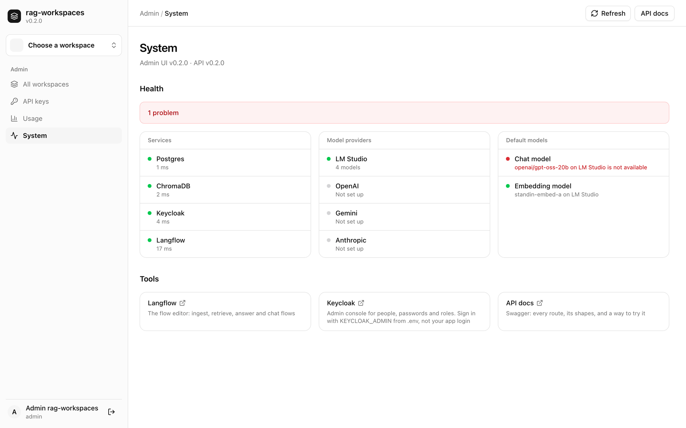

# Models and providers

Each workspace uses two models: an **embedding model**, which turns passages and questions into vectors for
search, and a **chat model**, which writes answers. Either can run locally in LM Studio or at a hosted
provider.

| Provider | Chat | Embeddings | Key |
|---|---|---|---|
| LM Studio (default, offline) | yes | yes | none |
| OpenAI | yes | yes | `OPENAI_API_KEY` |
| Google Gemini | yes | yes | `GEMINI_API_KEY` |
| Anthropic | yes | no: pick another provider for embeddings | `ANTHROPIC_API_KEY` |

The defaults for new workspaces come from `.env` (`DEFAULT_CHAT_PROVIDER`, `DEFAULT_CHAT_MODEL`,
`DEFAULT_EMBEDDING_PROVIDER`, `DEFAULT_EMBEDDING_MODEL`). `pnpm run setup` asks for them, listing the
models LM Studio has, and can be run again to change them.

## LM Studio

1. Download a chat model and an embedding model. The defaults are `openai/gpt-oss-20b` (about 12 GB) and
   `text-embedding-nomic-embed-text-v1.5`.
2. Load both and start the local server (Developer tab, port 1234). Load them yourself with `lms load`, so
   LM Studio doesn't swap one out for the other on every question.
3. Check the ids match `.env` exactly: `curl localhost:1234/v1/models`.

The containers reach LM Studio at `LMSTUDIO_BASE_URL` (`http://host.docker.internal:1234/v1`).

A thinking model such as Qwen 3 reasons before every answer, which can take minutes on a laptop. Set the
workspace's reasoning effort, or `DEFAULT_REASONING_EFFORT`, to `none` to answer at once.
[Setup](../setup.md#lm-studio-the-default-runs-offline) has more, and [Tuning](../tuning.md) compares
models on real questions.

## Hosted providers

There are two places a provider key can live:

- **In `.env`**, for every workspace. Run `docker compose up -d api` after adding it.
- **In one workspace's settings** ("Provider keys", admins), or in the create-workspace wizard when you pick
  a provider that has no key yet. The wizard checks the key by listing the provider's models before it saves
  anything.

A key saved for a workspace wins over `.env` for that workspace. Saved keys are encrypted with `SECRETS_KEY`
from `.env`; if that changes, saved keys can't be read and must be saved again (the workspace's runs fail
rather than quietly using `.env`'s key).

Keys never sit in Langflow's environment: the API passes them with each run
([poc/RESULTS.md](../../poc/RESULTS.md), F3).

## Changing models

- **Chat model**: change it in the workspace's settings at any time. The next answer uses it.
- **Embedding model**: fixed per workspace, because vectors from two models can't be compared. "Change…"
  next to it in settings starts a reindex with the new model ([Workspaces](workspaces.md#reindex)).

## Is it working?

Admins have a **System** page (last in the sidebar's Admin section), refreshed every 30 seconds. It shows
Postgres, ChromaDB, Langflow and Keycloak with their latency or error; each model provider, whether it is
set up, whether it answers and how many models it offers; and whether the default chat and embedding
models are available. It also links to the Langflow editor, the Keycloak admin console (sign in there with
`KEYCLOAK_ADMIN` from `.env`, not your app login) and the Swagger docs. The sidebar shows the release
everyone is running.

The same information is at `GET /v1/system`. The usual problem is LM Studio not running, or the model not
loaded.
