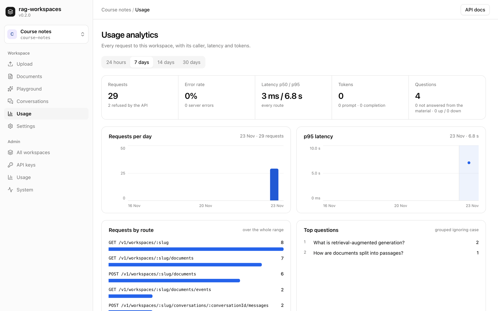

# Usage analytics

Every `/v1` request is logged: who made it (a person or an API key), the route, the status, how long it
took, the tokens a model used and, for questions, the question itself. "Usage" turns that into charts.

- **One workspace** ("Usage" inside a workspace): editors and admins.
- **All workspaces** ("Usage" at the top of the sidebar): admins.

Pick a time range at the top: 24 hours, 7, 14 or 30 days. The page shows:

| Part | What it tells you |
|---|---|
| Summary tiles | Requests and how many were refused, the error rate, p50 and p95 latency, tokens used, and questions: how many weren't answered from the material, and thumbs up and down |
| Requests per hour or day | Traffic over the range |
| p95 latency | How slow the slowest requests are, over time |
| Requests by route | Which parts of the API are used |
| Top questions | What people and agents ask most, grouped ignoring case |
| Most cited documents | Which material actually gets used in answers |
| Request log | Every request, filterable by route and status, with its caller and request id |

A question "not answered from the material" means no passage scored above the relevance threshold, so the
answer said the workspace doesn't cover it. Many of those point at missing material, or at a threshold set
too high ([Tuning](../tuning.md)).

Question text is cleared from the log after `USAGE_QUESTION_RETENTION_DAYS` (90 by default); the counts and
timings stay. Every response carries an `X-Request-Id` header, the same id the request log shows, so a
problem report can point at the exact request.

Through the API: `GET /v1/workspaces/{slug}/usage/summary`, `…/timeseries`, `…/top-questions`,
`…/top-documents` and `…/requests`, and the same under `/v1/usage/` across every workspace
([API schema](../api-schema.md#usage-analytics)).
