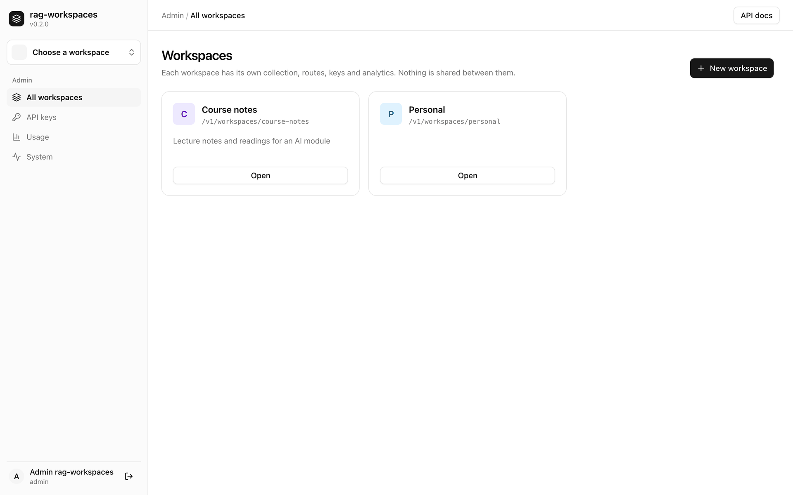
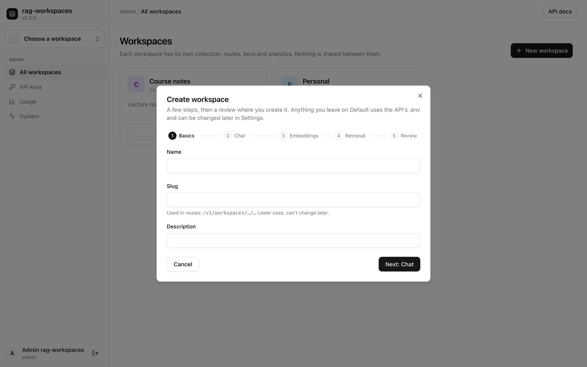
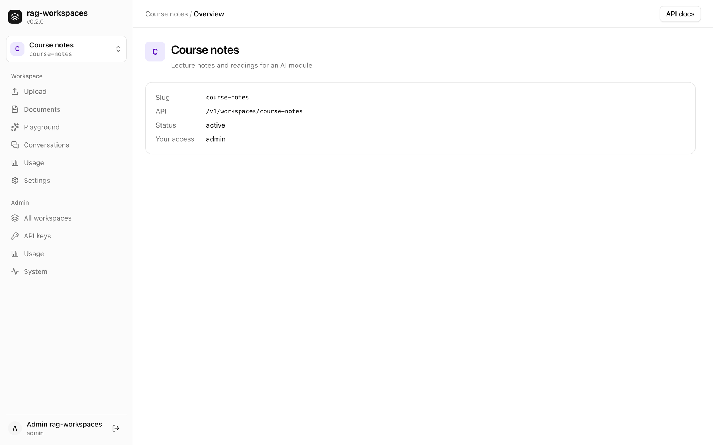
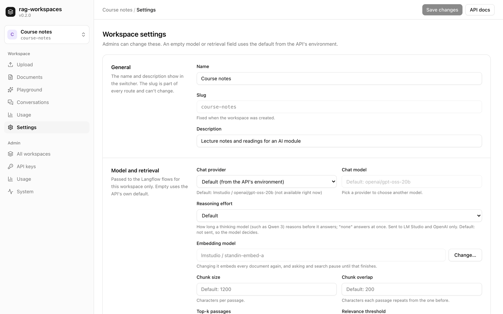

# Workspaces

A workspace is one isolated collection of material, for example `ouc` for course material or `personal`
for your own notes. Each has its own documents, its own vector index (a Chroma collection), its own
settings, its own members and its own API at `/v1/workspaces/{slug}`. Nothing is shared between
workspaces: a search in one never sees another's passages, and a person or key without access to a
workspace gets `404`, as if it didn't exist.

## Create one (admins)

"All workspaces", or "New workspace" in the sidebar's switcher, opens a wizard that leads you through
five steps. A timeline at the top shows where you are and lets you go back to any step you've done;
"Next" stays on a step until it is complete.

1. **Basics**: a name, a slug (the id in URLs, lowercase, fixed once created) and an optional description.
2. **Chat**: the provider and model that write answers, and the reasoning effort. A hosted provider with no
   key in `.env` asks for one first, checks it, and only then offers its models. The key is saved for this
   workspace only ([Models and providers](providers.md)).
3. **Embeddings**: the provider and model that index the material. A key checked on the Chat step is
   reused here.
4. **Retrieval**: chunk size and overlap, top-k, the relevance threshold and the system prompt (below).
   Anything left empty keeps the defaults from `.env`.
5. **Review**: everything you picked, and anything still unfinished with a link to its step. The workspace
   is created from here.

Through the API: `POST /v1/workspaces { "name": "OUC", "slug": "ouc" }`.

## Composite workspaces (admins)

A composite workspace has no documents of its own. It names two to ten ordinary workspaces as its
**sources**, for example `study` = `ouc` + `personal`, and answers, chats and searches across all of them,
with its own slug, members, API keys, chat model, system prompt, style and usage. One key for `study` is
enough for an agent to ask about both; access to a composite gives nothing else in its sources.

"New composite" on "All workspaces" asks for a name, a slug and the sources. A composite has no Upload or
Documents page (add material to its sources), and its Settings have a Sources section instead of the
embedding, chunking and threshold settings, which belong to each source. Each citation names the source
workspace it came from.

Through the API: `POST /v1/workspaces { "name": "Study", "slug": "study", "kind": "composite",
"sources": ["ouc", "personal"] }`.

## The overview page

Each workspace opens on an overview with its slug, its API base path, its status (`active` or
`reindexing`) and your access. The sidebar's switcher moves between workspaces; the admin UI remembers the
one you used last.

## Settings (admins)

"Settings" changes everything about a workspace except its slug. Leaving a field empty uses the default
from `.env`, and the page says what that default is.

| Setting | What it does | Default |
|---|---|---|
| Name, description | Shown in the admin UI and `GET /v1/workspaces` | |
| Chat provider and model | Writes answers and chat replies. The list comes from what each provider offers right now | `DEFAULT_CHAT_PROVIDER`, `DEFAULT_CHAT_MODEL` |
| Reasoning effort | How long a thinking model reasons before answering: `none` to `high`. Sent to LM Studio and OpenAI only | `DEFAULT_REASONING_EFFORT` (empty: not sent) |
| Embedding model | Turns text into vectors. Fixed per workspace: changing it means a reindex (below) | `DEFAULT_EMBEDDING_PROVIDER`, `DEFAULT_EMBEDDING_MODEL` at creation |
| Chunk size | Characters per passage | 1200 |
| Chunk overlap | Characters each passage repeats from the one before | 200 |
| Top-k passages | How many passages an answer may draw on and cite | 8 |
| Relevance threshold | Minimum similarity (0 to 1) for a passage to count. Below it, the answer says the material doesn't cover the question | `DEFAULT_MIN_SCORE` (0.3) |
| System prompt | The instructions the chat model gets. The box shows the default | Built in |
| Default response style | How answers read when a question picks no style (see [Response styles](playground.md#response-styles)) | None |

Chunk size and overlap apply to documents ingested after the change; reindex to apply them to the rest.
[Tuning answer quality](../tuning.md) explains how these values were chosen and how to test your own.

## Members (admins)

Everyone signs in with a Keycloak account, which an admin creates in Keycloak's console
(http://auth.rag.localhost/admin, realm `rag-workspaces`, "Users"). To let someone into a workspace, add
them under "Members" in its settings as a **reader** (ask, search, chat) or an **editor** (also upload,
reindex and delete documents). To make someone an admin of everything, give them the realm role `admin` in
Keycloak.

Through the API: `PUT /v1/workspaces/{slug}/members/{userId} { "role": "reader" }`, with the id from
`GET /v1/users`.

## Reindex

A reindex re-reads every document into a fresh index, with the current chunk settings and, if you pick a
new one, a new embedding model. Vectors from two embedding models can't be compared, so this is the only
way to change one. While it runs the workspace is `reindexing` and searches answer `503`; it is `active`
again once every document is `ready`.

## Delete

"Delete workspace" removes its documents, files, index, conversations and settings. It can't be undone.
Usage records are kept, since they count requests, not content.
