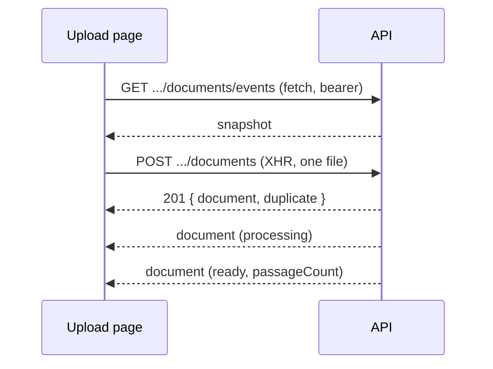

# Live per-file ingestion status over server-sent events in the admin UI

## Summary

The upload page now follows each uploaded file through ingestion live: after the upload answers, its
badge moves from Queued to Processing to Ready (with the passage count) or Failed (with the reason and a
Retry button), driven by the API's document events stream, with no reload. The stream reader is a
reusable hook, `useDocumentEvents()`, for the document library that follows. Builds on
`2026-11-22-admin-upload.md`.

## Why

Milestone M4 in `docs/work-breakdown.md`. The scope agreed with the owner: "drag-and-drop upload with a
progress bar and live status per file ... Live status uses the SSE stream from #17." The stream is in
`2026-11-20-document-events.md`; statuses and reindex in `2026-11-20-ingest-queue.md`. Split from the
upload PR to keep each reviewable (rule 2).

## Design

1. **Reading the stream** (`src/documents/use-document-events.ts`). `useDocumentEvents(slug, onEvent)`
   reads `GET /api/v1/workspaces/<slug>/documents/events` with `fetch` and a `ReadableStream` while the
   component is mounted, with the bearer token from `getToken()`. `onEvent` goes through
   `useEffectEvent`, so a new callback doesn't reconnect.
2. **Parsing** (`src/documents/sse.ts`). `createSseParser()` turns text chunks into events: `event` and
   `data` fields, comments (`:`, such as the 15-second keep-alive) skipped, frames ended by a blank line,
   frames split anywhere across chunks, LF, CRLF or CR line endings (a trailing CR waits for the next
   chunk in case it is half a CRLF). `toDocumentEvent()` (`src/documents/events.ts`) decodes `snapshot`
   (`{ data: Document[] }`), `document` (a full `Document`) and `removed` (`{ id }`), and skips anything
   else.
3. **Reconnecting**. When the stream ends, fails or is refused, the hook waits `reconnectDelay(attempt)`
   (1 s, doubling, at most 30 s), then connects again with a fresh token (`getToken()` renews an expired
   one). Each snapshot resets the backoff. The API sends a snapshot of every unfinished document on
   connect, so nothing is missed while disconnected. Unmounting aborts the request and the timer.
4. **Rows** (`src/documents/session.ts`). The reducer gains an `event` action and a `document` action
   (the answer to Retry). Documents are kept by id even before their upload answers, because the stream
   can report a document first, and an older copy (by `updatedAt`) never replaces a newer one. A removed
   document shows "Deleted from the library." Rows show "N passages" when ready, "Attempt N failed:
   <error>" when failed; the heading counts "N ready, M in progress" (files waiting their upload turn count as in progress).
5. **Retry** (`src/routes/upload.tsx`). On a failed document, `POST .../documents/<id>/reindex` through
   `api`; the answer (back to Queued) shows at once and the stream takes it from there. A refused retry
   shows the API's message above the list.

## Decisions and trade-offs

| Decision | Alternatives considered | Why this one |
| --- | --- | --- |
| `fetch` + `ReadableStream` | `EventSource` | `EventSource` can't send `Authorization` |
| Own parser | An SSE library | 40 lines, fully unit-tested, no dependency |
| Keep every document seen, keyed by id | Apply events only to rows that already have a document | An event can beat the upload's answer; this way no state is lost |
| Newest copy wins by `updatedAt` | Last event wins | The API subscribes before its snapshot, so a state can arrive twice and out of order |
| Retry for every attempt, no cap on reconnects | Give up after N tries | The page is useless without the stream; backoff keeps it cheap |
| One hook, the page decides what to do with events | A store shared by pages | The library will feed the same events into its query cache |

## Interfaces and contracts

- **HTTP API**: None changed. The UI now also calls `GET /api/v1/workspaces/{slug}/documents/events` and
  `POST /api/v1/workspaces/{slug}/documents/{id}/reindex` with the bearer token.
- **Configuration**: None.
- **Data**: None.
- **Langflow**: None.
- **Events and logs**: The UI reads the `snapshot`, `document` and `removed` events.
  `useDocumentEvents()` is the hook other screens use to stay live.

## Operations

Existing installs: `docker compose up -d --build web`. nginx already passes the stream unbuffered
(`proxy_buffering off`, `docker/admin/nginx.conf`). With the API stopped, the page keeps retrying every
30 s at most and catches up from the snapshot once it is back.

## Testing

- `apps/admin/src/documents/sse.test.ts`: one and several frames per chunk, frames split anywhere
  (including inside a CRLF), comments and keep-alives, multi-line data, missing space after the colon,
  frames without data, other fields; the reconnect backoff.
- `apps/admin/src/documents/session.test.ts`: event decoding; a row from upload to Ready via events,
  "1 passage", an event before the upload answer, older copies ignored, the reconnect snapshot,
  duplicates unaffected by events, failed then Retry, a deleted document, the summary.
- `apps/admin/e2e/upload.spec.ts` (real stack: API, Langflow, a model server) now checks that the page
  opens the stream and that each row goes Uploading, then Queued or Processing, then Ready with passages,
  without a reload. Ingestion of a small file takes about a second, so a `MutationObserver` records every
  status the row shows and the test checks the order instead of waiting for each badge.

By hand: upload a file, stop the API while it is processing, start it again, and watch the row catch up.

## Out of scope and follow-ups

The document library, which keeps its list live with the same hook (`2026-11-22-admin-library.md`). A
"live / reconnecting" indicator. No failed ingestion in the e2e run (the stand-in model server always
succeeds), so Retry is covered by unit tests and checked by hand.

## Docs updated

`README.md` (uploads are followed through ingestion live).
