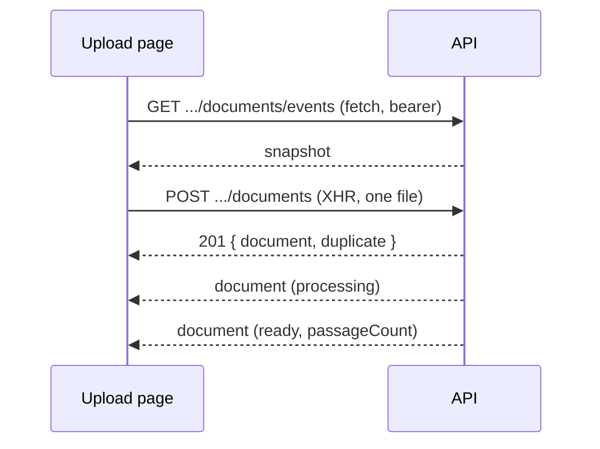

# Live per-file ingestion status over server-sent events in the admin UI

## Summary

The upload page now follows each uploaded file through ingestion live: after the upload answers, its
badge moves from Queued to Processing to Ready (with the passage count) or Failed (with the reason and a
Retry button), driven by the API's document events stream, with no reload. The stream reader is a
reusable hook, `useDocumentEvents()`, for the document library that follows. Builds on
`2026-11-22-admin-upload.md`.

## Why

Milestone M4 in `docs/work-breakdown.md`. The scope agreed with the owner: "drag-and-drop upload with a
progress bar and live status per file ... Live status uses the SSE stream from #17." The stream is in
`2026-11-20-document-events.md`; statuses and reindex in `2026-11-20-ingest-queue.md`. Split from the
upload PR to keep each reviewable (rule 2).

## Design

1. **Reading the stream** (`src/documents/follow-events.ts`, `src/documents/use-document-events.ts`).
   `followDocumentEvents()` is the React-free core: it reads `GET /api/v1/workspaces/<slug>/documents/events`
   with `fetch` and a `ReadableStream` until its `AbortSignal` aborts, with the bearer token sent through
   `sendAuthorized()` (from `2026-11-22-admin-upload.md`). `useDocumentEvents(slug, onEvent)` runs it while
   the component is mounted and aborts it on unmount or when the slug changes, so a new workspace opens a
   new stream. `onEvent` goes through `useEffectEvent`, so a new callback doesn't reconnect. Nothing is
   emitted once the signal has aborted, and documents whose `workspace` isn't the slug are dropped.
2. **Parsing** (`src/documents/sse.ts`). `createSseParser()` turns text chunks into events: `event` and
   `data` fields, comments (`:`, such as the 15-second keep-alive) skipped, frames ended by a blank line,
   frames split anywhere across chunks, LF, CRLF or CR line endings (a trailing CR waits for the next
   chunk in case it is half a CRLF). `toDocumentEvent()` (`src/documents/events.ts`) decodes `snapshot`
   (`{ data: Document[] }`), `document` (a full `Document`) and `removed` (`{ id }`), validating each body
   with the shared zod schemas (`safeParse`), and skips unknown events and bodies that don't match, so a
   bad frame is dropped instead of breaking the page. `zod` is now a direct dependency of the admin app,
   at the same pinned version as `@rag/shared`, to wrap `Document` in the snapshot's `{ data }`.
3. **Reconnecting**. When the stream ends or fails, the hook waits `reconnectDelay(attempt)` (1 s,
   doubling, at most 30 s), then connects again with a fresh token (`getToken()` renews an expired one).
   Each snapshot resets the backoff. Unmounting aborts the request and the wait. Refusals: a `401` renews
   the token once and connects again; a second `401` ends the session (the path `api` takes). A `403` or
   `404` stops retrying and the page shows "Live updates stopped: <reason>".
4. **Catching up**. The API's snapshot holds only unfinished documents (queued, transcribing,
   processing), so a document that finished or was deleted while the stream was down is simply missing
   from it. On every snapshot the upload page takes each of its rows whose document it last saw
   unfinished and that the snapshot doesn't list (`missingFromSnapshot()`), and fetches it with
   `GET /v1/workspaces/<slug>/documents/<id>`; the answer is merged like any event, and a `404` marks the
   row Deleted.
5. **Rows** (`src/documents/session.ts`). The reducer gains an `event` action and a `document` action
   (the answer to Retry). Documents are kept by id even before their upload answers, because the stream
   can report a document first, and an older copy (by `updatedAt`) never replaces a newer one. With the
   same `updatedAt`, the known copy stays unless the new one is further along (queued, transcribing,
   processing, then ready or failed). A removed
   document shows "Deleted from the library." Rows show "N passages" when ready, "Attempt N failed:
   <error>" when failed; the heading counts "N ready, M in progress" (files waiting their upload turn count as in progress).
6. **Retry** (`src/routes/upload.tsx`). On a failed document, `POST .../documents/<id>/reindex` through
   `api`; the answer (back to Queued) shows at once and the stream takes it from there. Each row keeps its
   own Retry state: the button (labelled "Retry <file name>") is disabled while its request is pending,
   and a refused retry shows the API's message under that row.

## Decisions and trade-offs

| Decision | Alternatives considered | Why this one |
| --- | --- | --- |
| `fetch` + `ReadableStream` | `EventSource` | `EventSource` can't send `Authorization` |
| Own parser | An SSE library | 40 lines, fully unit-tested, no dependency |
| Keep every document seen, keyed by id | Apply events only to rows that already have a document | An event can beat the upload's answer; this way no state is lost |
| Newest copy wins by `updatedAt` | Last event wins | The API subscribes before its snapshot, so a state can arrive twice and out of order |
| Retry for every attempt, no cap on reconnects | Give up after N tries | The page is useless without the stream; backoff keeps it cheap. A `403` or `404` is final, so those stop |
| Fetch rows the snapshot no longer lists | Ask the API to include finished documents in the snapshot | The API and its merged spec stay as they are; only this session's few rows need it |
| Validate frames with the shared zod schemas | Cast the parsed JSON | A malformed or changed frame is skipped instead of breaking the page; the schemas already exist |
| One hook, the page decides what to do with events | A store shared by pages | The library will feed the same events into its query cache |

## Interfaces and contracts

- **HTTP API**: None changed. The UI now also calls `GET /api/v1/workspaces/{slug}/documents/events`,
  `GET /api/v1/workspaces/{slug}/documents/{id}` and `POST /api/v1/workspaces/{slug}/documents/{id}/reindex`
  with the bearer token. `docs/api-schema.md` now gives the snapshot's real shape, `{ data: Document[] }`
  with unfinished documents only (the merged `2026-11-20-document-events.md` says `{ items }`).
- **Configuration**: None.
- **Data**: None.
- **Langflow**: None.
- **Events and logs**: The UI reads the `snapshot`, `document` and `removed` events.
  `useDocumentEvents()` is the hook other screens use to stay live.

## Operations

Existing installs: `docker compose up -d --build web`. nginx already passes the stream unbuffered
(`proxy_buffering off`, `docker/admin/nginx.conf`). With the API stopped, the page keeps retrying every
30 s at most and catches up from the snapshot, and the documents it no longer lists, once it is back.
Each open tab holds one HTTP/1.1 connection for the stream (browsers allow six per host over HTTP/1.1).

## Testing

- `apps/admin/src/documents/sse.test.ts`: one and several frames per chunk, frames split anywhere
  (including inside a CRLF), comments and keep-alives, multi-line data, missing space after the colon,
  frames without data, other fields; the reconnect backoff.
- `apps/admin/src/documents/follow-events.test.ts`: drives `followDocumentEvents()` with a mocked `fetch`
  that returns a `ReadableStream` the test writes to: events are emitted with the bearer token; bad
  frames and other workspaces' documents are skipped; it reconnects with backoff after the stream ends
  and a snapshot resets it; aborting ends the request and emits nothing more; a new slug connects to its
  own URL; a `401` renews once, then ends the session; `403` and `404` stop with the reason.
- `apps/admin/src/documents/session.test.ts`: event decoding and schema validation; a row from upload to Ready via events,
  "1 passage", an event before the upload answer, older copies ignored, the reconnect snapshot,
  duplicates unaffected by events, equal `updatedAt` ranked by status, Retry pending and refused per
  row, failed then Retry, a deleted document, the documents a snapshot no longer lists, the summary.
- `apps/admin/e2e/upload.spec.ts` (real stack: API, Langflow, a model server) now checks that the page
  opens the stream and that each row goes Uploading, then Queued or Processing, then Ready with passages,
  without a reload. Ingestion of a small file takes about a second, so a `MutationObserver` records every
  status the row shows and the test checks the order instead of waiting for each badge. A second test
  keeps the stream down (`page.route` aborts it) while a file is ingested, then lets it back and sees
  the page fetch the document and show Ready.

By hand: upload a file, stop the API while it is processing, start it again, and watch the row catch up.

## Out of scope and follow-ups

The document library, which keeps its list live with the same hook (`2026-11-22-admin-library.md`). A
"live / reconnecting" indicator. No failed ingestion in the e2e run (the stand-in model server always
succeeds), so Retry is covered by unit tests and checked by hand.

## Docs updated

`README.md` (uploads are followed through ingestion live). `docs/api-schema.md` (the events route's
snapshot shape, and that it lists unfinished documents only).
