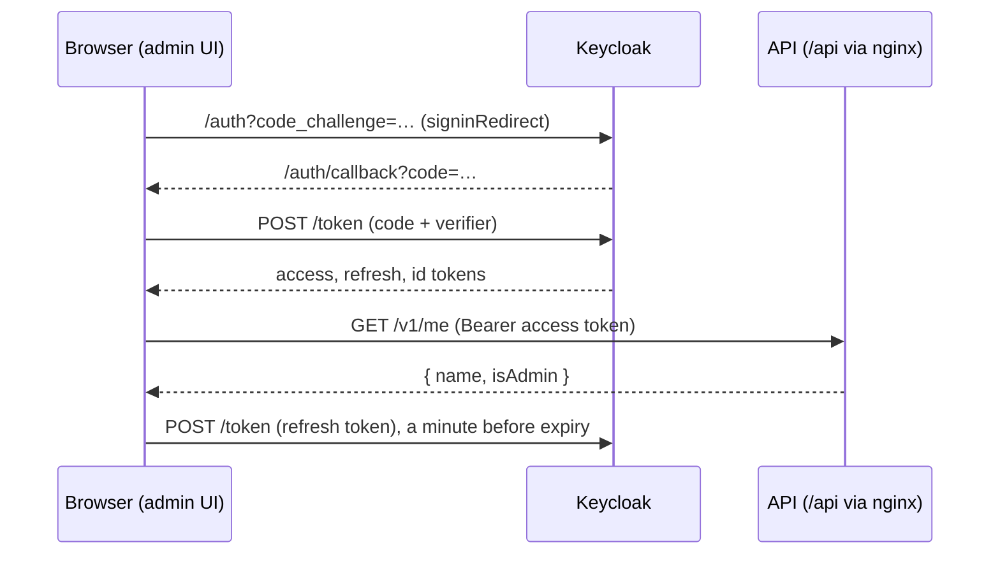

# Keycloak sign-in and the app layout for the admin UI

## Summary

The admin UI now requires a Keycloak sign-in. A person clicks "Continue with Keycloak" and signs in on
Keycloak's own page. Keycloak sends them back with a code, which the UI swaps for tokens using PKCE. The
UI renews the access token before it expires, sends it as `Authorization: Bearer` on every `/api` call,
and shows the person in a sidebar with a sign-out button. This is the first of three admin UI PRs in
milestone M4 (sign-in, then workspaces, then upload and library). It also adds the first Playwright test,
which signs in through the real Keycloak.

## Why

Milestone M4 in `docs/work-breakdown.md`: Keycloak login against the real API. Decision 8 (Keycloak for
login, accounts made by an admin). The `admin-ui` client in `docker/keycloak/realm.json` was set up for
this in #6: public client, standard flow only, PKCE `S256`, redirect URIs `${ADMIN_UI_URL}/*` and
`http://localhost:5173/*`. The API side (token checks, `GET /v1/me`) is in
`2026-11-20-keycloak-auth.md`. Workstream 3 item 10 asks for Playwright tests for login. The screens
follow the approved mocks (Sign in and the sidebar of every other screen).

## Design

1. **Configuration** (`apps/admin/src/auth/oidc.ts`). The Keycloak URL comes from `VITE_KEYCLOAK_URL`,
   baked in when Vite builds; the realm (`rag-workspaces`) and client (`admin-ui`) are constants, because
   `realm.json` fixes them. `docker/admin.Dockerfile` takes a `KEYCLOAK_PUBLIC_URL` build argument and
   `docker-compose.yml` passes the same variable the API uses, so the two always agree. The default is
   `http://localhost:8081`.
2. **Sign-in** (`oidc.ts`, `oidc-client-ts`'s `UserManager`). The sign-in page
   (`src/routes/sign-in.tsx`) calls `signinRedirect()`, which makes a PKCE verifier and goes to Keycloak.
   Keycloak returns to `/auth/callback` (`src/routes/auth-callback.tsx`), which calls
   `signinRedirectCallback()` to swap the code for tokens and then goes to the page the person first
   asked for.
3. **Session** (`src/auth/auth-provider.tsx`). A React context holds the signed-in user and their
   `GET /v1/me` record (name, `isAdmin`). Tokens live in `sessionStorage` (the library's default), so a
   reload keeps the session but a new tab signs in again (Keycloak's own session cookie makes that a
   redirect without a password).
4. **Refresh**. `automaticSilentRenew` renews the access token a minute before it expires (Keycloak's
   lifespan is 15 minutes) with the refresh token. A token that has already expired (after a reload, or
   when the computer wakes from sleep) is renewed before it is used. If Keycloak refuses the refresh
   token (`src/auth/renew-error.ts`: an OAuth error such as `invalid_grant`), the session ends and the
   person lands on the sign-in page; if Keycloak is only unreachable, the session is kept and renewal
   tries again.
5. **API calls** (`src/api/client.ts`). `apiFetch(path, init)` prefixes `/api`, adds the bearer token,
   and turns problem JSON into an `ApiError` with the status and `detail`. A `401` signs the person out
   locally and sends them to sign in again.
6. **Routes** (`src/router.tsx`, React Router). `/sign-in` and `/auth/callback` are public. Everything
   else is under `RequireAuth`, which sends anonymous visitors to `/sign-in?returnTo=<path>`, and renders
   inside `AppLayout`; unknown paths show a not-found page. `returnTo` is resolved like a URL and kept
   only if it stays on this origin (`src/auth/return-to.ts`). If Keycloak can't be reached, the sign-in
   page says so instead of doing nothing.
7. **Layout** (`src/components/app-layout.tsx`). The mock's sidebar: product name, the person's name and
   role at the bottom, and a sign-out button that calls `signoutRedirect()` (Keycloak ends its session
   and returns to `/`). Nav sections for workspaces arrive with the screens that fill them. The home page
   (`src/routes/home.tsx`) keeps the API readiness card from #9.
8. **Playwright** (`apps/admin/e2e/`). `sign-in.spec.ts` opens the UI, is sent to sign in, signs in on
   the real Keycloak page as the seeded admin, sees their name and `admin` in the sidebar, reloads and is
   still signed in, then signs out. `pnpm --filter @rag/admin e2e` runs it against a running stack. The
   CI job joins the stack overlay from the smoke-test PR once that lands.

## Decisions and trade-offs

| Decision | Alternatives considered | Why this one |
| --- | --- | --- |
| `oidc-client-ts` | `keycloak-js`; writing PKCE and refresh by hand | Standard OIDC, so not tied to Keycloak; handles PKCE, state, refresh and sign-out, and is widely used. Hand-written token code is easy to get subtly wrong |
| Tokens in `sessionStorage` | Memory only; `localStorage` | Survives a reload without a redirect; gone when the tab closes; not shared across tabs like `localStorage` |
| Keycloak URL baked in at build time | Served at runtime as `/config.json` from nginx | One build argument from the same `.env` value; changing it means `docker compose up --build`, which is rare |
| Our own sign-in page with one button | Redirect to Keycloak straight away | Matches the approved mock and explains that accounts are made by an admin |
| `401` from the API signs out locally | Retry after a silent renew | Renewal already runs before expiry; a `401` after that means the session is really gone |
| React Router now | Hand-written path checks for the callback | The callback and the guard need routes, and the next PRs add screens |
| Playwright against the real stack | Faking Keycloak and the API in the browser | Chosen by Guilherme: only a real login proves sign-in works |

## Interfaces and contracts

- **HTTP API**: None changed. The UI calls `GET /api/v1/me` with the bearer token.
- **Configuration**: build argument `KEYCLOAK_PUBLIC_URL` on `docker/admin.Dockerfile` (default
  `http://localhost:8081`), passed by the `web` service in `docker-compose.yml`; `VITE_KEYCLOAK_URL` for
  `pnpm --filter @rag/admin dev`. For e2e: `E2E_BASE_URL` (default `http://localhost:8080`),
  `E2E_USERNAME` and `E2E_PASSWORD` (default: `RW_ADMIN_USERNAME` and `RW_ADMIN_PASSWORD` from the
  environment).
- **Data**: `sessionStorage` key `oidc.user:<authority>:admin-ui` (owned by `oidc-client-ts`).
- **Langflow**: None.
- **Events and logs**: None.

## Operations

Existing installs: `docker compose up -d --build web`. If `KEYCLOAK_PUBLIC_URL` or `ADMIN_UI_URL` ever
change, rebuild `web`; Keycloak only reads the redirect URIs when it first imports the realm, so a changed
`ADMIN_UI_URL` also needs the client's redirect URIs edited in the Keycloak console. Nothing is hard to
undo.

## Testing

- `apps/admin/src/api/client.test.ts`: the bearer header and `/api` prefix, problem JSON to `ApiError`,
  and the sign-out on `401`.
- `apps/admin/src/auth/return-to.test.ts`: the `returnTo` path only accepts same-origin paths (including
  tricks like `/\t/evil.example`), so the callback can't be used to send someone to another site.
- `apps/admin/src/auth/renew-error.test.ts`: a refused refresh token ends the session, a network error
  doesn't.
- `apps/admin/e2e/sign-in.spec.ts`: the real login, reload and sign-out; `returnTo` after sign-in;
  the message when Keycloak is unreachable; an unknown address sends an anonymous visitor to sign in.

By hand (zsh): `docker compose up -d --build`, open http://localhost:8080, sign in with
`RW_ADMIN_USERNAME` and `RW_ADMIN_PASSWORD` from `.env`, then run
`pnpm --filter @rag/admin exec playwright install chromium` once and `pnpm --filter @rag/admin e2e`.

## Out of scope and follow-ups

The workspace switcher and list (next PR), upload and library (the one after), playground, analytics,
keys and settings (later M4 steps). A branded Keycloak login theme and an "add person" screen were
suggested but not accepted, so they are left out. The CI job for Playwright is added on top of the
smoke-test stack once that PR exists.

## Docs updated

`README.md` (signing in to the admin UI, and the e2e command); `docs/architecture.md` (React Router in the stack table).
