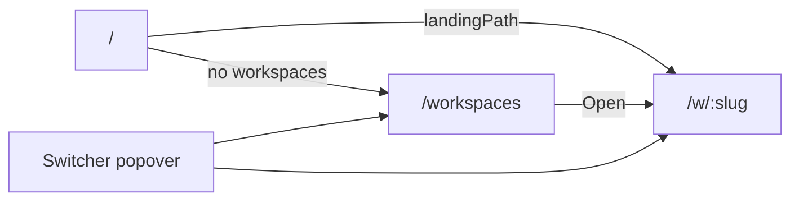

# Workspace switcher, workspace list and workspace pages in the admin UI

## Summary

After signing in, the admin UI opens the workspace the person used last (or their first one). A switcher
under the logo shows the current workspace and lists the others. An "All workspaces" page shows a card
per workspace the person can see. Each workspace has a home page at `/w/<slug>`, which the upload and
library screens extend later. This PR only reads workspaces; the admin's "Create workspace" dialog follows
in `2026-11-22-admin-create-workspace.md`. It is the second admin UI PR in milestone M4, after sign-in
(`2026-11-22-admin-sign-in.md`).

## Why

Milestone M4 in `docs/work-breakdown.md`: the admin UI against the real API. Decision 2 (isolated
workspaces): every screen after this one belongs to one workspace, so the UI needs a current workspace
and a way to change it. The API side (`GET /v1/workspaces`, `GET /v1/workspaces/{slug}`, 404 for no
access) is in `2026-11-20-workspaces.md`. The layout and copy follow the approved "Workspaces" mock. The
scope agreed with the owner: the switcher, the list and (in the next PR) an admin-only create dialog; the
sidebar only links to screens that exist; cards leave out document and passage counts because the API
does not return them yet. The work was split in two to keep each PR reviewable (rule 2).

## Design

1. **Data fetching** (`src/main.tsx`, `src/workspaces/queries.ts`). TanStack Query caches API reads.
   `useWorkspaces()` reads `GET /v1/workspaces` (key `['workspaces']`) and `useWorkspace(slug)` reads
   `GET /v1/workspaces/<slug>` (key `['workspaces', slug]`). Every call goes through `api` from
   `useAuth()`, so it carries the bearer token and a `401` still signs the person out. `shouldRetry`
   retries network and `5xx` errors twice and never a `4xx`, so a `404` shows at once.
2. **Routes** (`src/router.tsx`), all inside `RequireAuth` and `AppLayout`, before the `*` not-found
   route:
   - `/` (`src/routes/root-redirect.tsx`) waits for the list and goes to `landingPath()`
     (`src/workspaces/landing.ts`): the last used workspace if it is still in the list, else the first,
     else `/workspaces`.
   - `/workspaces` (`src/routes/workspaces.tsx`): the "All workspaces" grid. Each card has the avatar
     initial, name, `/v1/workspaces/<slug>`, description and an Open button.
   - `/w/:slug` (`src/routes/workspace-layout.tsx`) is a layout route: it loads the workspace, shows a
     "not found or no access" state on `404` (and on `400`, which the API sends for a malformed slug), remembers the slug as the last used one, and passes the
     workspace to its children through the outlet context (`useCurrentWorkspace()` in
     `src/workspaces/current.ts`). Its index child (`src/routes/workspace-home.tsx`) shows the name,
     slug, description, status and the caller's access. Upload and documents join as children later.
3. **Last used workspace** (`landing.ts`). The slug is kept in `localStorage` under
   `rw.lastWorkspace`. Reads and writes are wrapped in `try/catch`, because storage can be blocked; then
   `/` simply opens the first workspace.
4. **Sidebar** (`src/components/app-layout.tsx`, `src/components/workspace-switcher.tsx`). Under the logo,
   the switcher button shows the current workspace (from the `/w/:slug` URL) or "Choose a workspace". Its
   popover lists every workspace the caller can see and an "All workspaces" row, so everyone, non-admins
   included, can reach the list. Below it, admins see an "Admin" section with "All workspaces". The
   workspace nav from the mock (Dashboard, Upload, Documents and so on) is left out until those screens
   exist.
5. **Top bar** (`src/components/top-bar.tsx`). Each page shows a breadcrumb and the "API docs" link
   (`/api/docs/`), as in the mock's "Swagger /docs" button.
6. **States** (`src/components/states.tsx`). Every query shows loading, error (with the API's message and
   a "Try again" button) and empty. With no workspaces, admins see "No workspaces yet" (created by an
   administrator, with `POST /v1/workspaces` until the next PR adds the dialog) and others see "You don't
   have access to any workspace yet. Ask an administrator."

## Decisions and trade-offs

| Decision | Alternatives considered | Why this one |
| --- | --- | --- |
| TanStack Query for API reads | `useEffect` per screen, as the home page did | Loading, error and retry are needed on every screen from here on, and the create dialog will refresh the cached list; hand-written versions drift |
| No retries on `4xx` | The library default (three retries for everything) | A `404` (no access) must show straight away, not after seconds of retries |
| `/w/:slug` as a layout route that loads the workspace once | Each screen loads it | The upload and documents screens share the loading and not-found states |
| Last workspace in `localStorage` | `sessionStorage`; a user preference in the API | Should survive closing the tab; a preference API is more than this needs. It's only a hint: a slug that is gone falls back to the first workspace |
| Removed the home page and its API readiness card | Keep it at `/` or under `/w/:slug` | `/` now redirects, and nothing else used it (rule 1). The API docs link moved to the top bar, as in the mock; a status panel returns with the dashboard |
| Copied shadcn `popover`, using the card colours | A component library; new popover colour tokens | Same approach as `button.tsx`; no new tokens for one surface |
| Only node unit tests for the logic, no component tests | jsdom and Testing Library | Landing and retry logic are plain functions; the screens are covered by the Playwright test against the real stack |
| Avatar tint picked from the slug | One colour for all; stored per workspace | Tells workspaces apart at a glance, as in the mock, without a new field |
| Cards show no counts and no Settings button | Zeros or placeholders | The API has no `stats` yet and the settings screen does not exist |

## Interfaces and contracts

- **HTTP API**: None changed. The UI calls `GET /api/v1/workspaces` and `GET /api/v1/workspaces/{slug}`
  with the bearer token.
- **Configuration**: None.
- **Data**: `localStorage` key `rw.lastWorkspace` in the browser (the last opened slug).
- **Langflow**: None.
- **Events and logs**: None.

## Operations

Existing installs: `docker compose up -d --build web`. Nothing is hard to undo.

## Testing

- `apps/admin/src/workspaces/landing.test.ts`: `landingPath()` prefers the last slug if it still exists,
  then the first, then `/workspaces`; the storage helpers survive blocked storage.
- `apps/admin/src/workspaces/queries.test.ts`: `shouldRetry()` skips `4xx`, retries others twice.
- `apps/admin/e2e/workspaces.spec.ts`: the admin signs in, creates two workspaces with unique slugs
  (`e2e-<time>-a`/`-b`) through the API with the page's bearer token, finds them in "All workspaces",
  opens one from its card, switches to the other in the switcher, checks that `/` reopens the last one,
  sees the not-found state for an unknown slug, and deletes the workspaces at the end. `e2e/sign-in.ts`
  holds the sign-in steps shared with `sign-in.spec.ts`, whose "returns to the page asked for" test now
  asks for `/workspaces?from=e2e`, because `/` redirects.

By hand: create two workspaces with `POST /v1/workspaces`, sign in as an admin, check that `/` opens the
last workspace, switch with the switcher, open `/w/nope` (not-found state). Sign in as a person with no
workspaces to see the "Ask an administrator" message.

## Out of scope and follow-ups

The "Create workspace" dialog (`2026-11-22-admin-create-workspace.md`). Upload and the document library
(`/w/:slug/upload` and `/w/:slug/documents`). Workspace model and retrieval settings, members, renaming
and deleting a workspace (settings screen, later in M4). Document, passage and member counts on the cards
(when the API returns `stats`). The dashboard with an API status panel.

## Docs updated

`README.md` (what the admin UI opens on after signing in).
