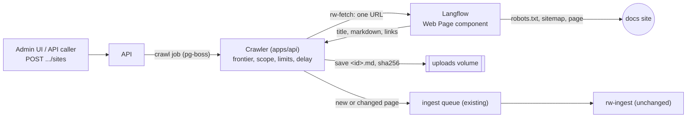

# Import a documentation website into a workspace

## Summary

An editor gives a workspace the start URL of a documentation website. The system crawls the site
(same host, under the start URL's path, honouring robots.txt and the sitemap, within page and depth
limits, one request at a time), turns each page into clean Markdown without navigation and other
boilerplate, and ingests every page as its own document whose source is the page URL, so answers cite
and link the page. Crawling the site again refreshes changed pages, adds new ones and removes pages
that are gone. This spec is the design for the whole feature; it lands as a small stack of PRs
(see "Out of scope and follow-ups"), and each later PR adds its own short spec that points here.

## Why

Guilherme asked to "add support for scraping a docs website" (2026-11-23). Course and tool documentation
often lives on websites, not in files, and today the only way in is to save pages by hand and upload
them. The feature has to keep the settled decisions:

- Decision 3: ingestion runs as a Langflow flow; the API keeps the bookkeeping.
- Decision 18: one direction, the API calls Langflow. So the API must not fetch web pages itself:
  loading is Langflow's job.
- Decision 2: workspaces are isolated, so a site belongs to one workspace.

Langflow 1.13.3's stock **URL** component (`lfx/components/data_source/url.py`) was checked first. It
follows links up to depth 5 on the same domain (not the same path), has no robots.txt, sitemap, page limit
or delay between requests, and keeps menus, sidebars and footers in the text, which would be repeated in
every passage and pollute search. It does show the parts worth reusing, all present in the 1.13.3 image:
markitdown (HTML to Markdown), BeautifulSoup with lxml, and `lfx.utils.ssrf_protection` /
`lfx.utils.ssrf_transport` (DNS-pinned fetching that refuses private addresses).

## Design

### 1. A site record

`POST /v1/workspaces/{slug}/sites` with `{ url, folderId?, maxPages?, maxDepth?, excludePaths? }` creates
a row in a new `sites` table and queues a crawl. The **scope** is fixed from the start URL: same scheme and
host, and a path under the start URL's directory. A start URL without a trailing slash counts as a
directory (`https://auth0.com/docs` gives `https://auth0.com/docs/`, `https://docs.example.org/guide/intro`
gives `https://docs.example.org/guide/intro/`) unless its last segment is a file name
(`/guide/index.html` gives `/guide/`); to crawl a whole section, start from the section.
`excludePaths` is a list of path prefixes left out of the scope, typically translations
(`/docs/fr-ca/`, `/docs/ja-jp/`). Defaults: `maxPages` 1,000 (1 to 10,000), `maxDepth` 10 (1 to 20). Pages
go into `folderId` when given. A workspace may hold several sites; the same start URL twice in one
workspace is a 409.

The first real target is `https://auth0.com/docs` (checked 2026-11-23): a Mintlify site whose
`/docs/sitemap.xml` lists about 7,000 pages, 2,300 of them English and the rest under `fr-ca`, `ja-jp` and
`ko-kr`; robots.txt allows `/docs` (with a few disallowed paths) but its `Sitemap:` line points at the
site-wide index, not the docs sitemap; it publishes `/docs/llms.txt`, and every page has a clean Markdown
twin at `<page>.md` (`text/markdown`). The defaults and the Markdown path below are sized for that: at one
request a second a full English crawl takes about 40 minutes, and embedding 2,300 pages on LM Studio
longer.

### 2. The crawl job (`apps/api/src/services/crawl.ts`)

A pg-boss queue `crawl`, one crawl at a time across the install, separate from `ingest` so pages are
ingested while the crawl continues. The job:

1. Asks `rw-fetch` in `sitemap` mode for the site. The component reads robots.txt, collects its
   `Sitemap:` lines plus `<scope>sitemap.xml` and `/sitemap.xml`, follows sitemap indexes (at most 50
   sitemap files), and returns the URLs, robots.txt's `Crawl-delay`, and whether `<scope>llms.txt` exists.
   Sitemap URLs inside the scope seed the frontier at depth 0, next to the start URL.
2. Takes URLs breadth first. For each, calls `rw-fetch` in `page` mode and waits
   `max(CRAWL_DELAY_MS, Crawl-delay)` before the next request to the same site.
3. Normalises every link the page returned (resolve against the final URL, drop `#fragment`, drop
   common tracking parameters, lower-case the host) and keeps it only when it is in scope, not seen yet,
   not an obvious non-page (`.png`, `.pdf`, `.zip` and similar), and within `maxDepth`. A page's
   `<link rel=canonical>` inside the scope replaces its URL, so `/guide/` and `/guide/index.html`
   become one document.
4. Stops at `maxPages` fetched pages.

The frontier lives in memory. A crash or restart re-queues the site's crawl from the start (the same
recovery-on-start as ingestion); unchanged pages cost one fetch each and no ingestion, so this is cheap
and avoids a table of URLs.

### 3. Each fetched page becomes a document

The crawler hashes the page's Markdown, claims the document row first (insert, or a guarded update that
skips a busy row), then writes the file to `<slug>/<document id>.md` on the uploads volume (the same layout
as uploads) and enqueues ingestion; if the write fails the row is put back. Then:

| Situation | What happens |
| --- | --- |
| No document for this site and URL | Insert a document (type `web`, `sourceUrl`, `siteId`, title from the page) and enqueue ingestion |
| Same URL, same SHA-256 | Nothing (no re-embedding) |
| Same URL, new content | Replace the file, update `sha256`, `sizeBytes`, `title`, set `queued`, enqueue. Ingestion deletes the old vectors first, as it already does |
| Same content as another page of the site | Not stored again; counted unchanged |
| 404 or 410 for a known page | The page's document is removed (vectors, file, row) |
| Other fetch error (5xx, timeout) | Counted in `pagesFailed` with the last error; a known page keeps its document; the crawl goes on |
| robots.txt now disallows a known page | Removed: the owner asked crawlers to stay out |
| Known page's document is `queued`, `transcribing` or `processing` | Left alone this crawl and counted unchanged; the next crawl picks up any change. The crawler never replaces a file an ingest run may be reading |
| A known page's new content equals another page of the site | Kept as it was and counted unchanged; it is never removed for being a duplicate |
| Redirect that ends outside the site's scope | Counted in `pagesFailed`; nothing is stored or followed; a known page keeps its document |
| Known page whose URL `excludePaths` now leaves out | Removed at the start of the crawl |

**Duplicates.** Content dedup for pages is per site, not per workspace: the workspace-wide unique index
on `(workspace_id, sha256)` becomes partial (`WHERE site_id IS NULL`), and pages get a unique index on
`(site_id, sha256)`. So a page that matches an uploaded file is still imported and cited by its URL, and two
URLs with the same content inside a site keep the first one reached.

**Removal is per page, never by absence.** Every page the site already has is queued at the start of a
crawl, after the start URL and the sitemap, so it is fetched again even when nothing links to it any more.
A page is removed only when its own fetch says so (404, 410, robots.txt) or `excludePaths` now leaves it
out. A page that errors, or that the crawl did not reach before `maxPages`, keeps its document. A
partial crawl, a sitemap that could not be read, or a flaky site can therefore never empty a workspace.

**Other routes.** A crawl that starts while the workspace is `reindexing` waits (the job retries with
backoff). A site's page documents can still be moved, renamed or deleted through the documents routes; a
deleted page comes back on the next crawl if it is still on the site. Changing a site's `folderId` moves its
existing pages as a document move does (passage metadata updated in place, no re-embedding).

The stored file is plain Markdown, so the existing `WorkspaceDocumentLoader` (`.md`) and the whole ingest
path are unchanged: checksum, queue, statuses, retries, reindex, delete.

### 4. Fetching and cleaning a page in Langflow

A new flow `rw-fetch` (`flows/fetch.json`): `Fetch` (new custom component
`WorkspaceWebPage`, `langflow/components/rag_workspaces/web_page.py`) → `ChatOutput-result`. The component:

- Fetches with httpx through Langflow's SSRF guard (DNS pinning, private addresses refused), following
  redirects with each hop re-checked, a 15 s timeout, a 5 MB
  body cap, and the user agent `rag-workspaces-crawler`.
- Checks robots.txt (stdlib `urllib.robotparser`, cached per host for the life of the Langflow worker)
  and returns `blocked: true` instead of fetching a disallowed page.
- **Markdown twin first.** When the site publishes `llms.txt` (the API passes `prefer_markdown`), the
  component first asks for `<url>.md`; a `200` with `text/markdown` or `text/plain` is used as the page
  (the links still come from the HTML page, fetched second only when the frontier needs them, that is
  below `maxDepth` and when the sitemap did not already list the site). A leading "Documentation Index"
  note pointing at `llms.txt` is dropped. Anything else falls back to the HTML path below.
- Accepts `text/html` (and `text/markdown` / `text/plain` as they are). Other types return
  `skipped: "<content type>"`.
- Collects every `<a href>` on the page **before** cleaning, because navigation is where the links are.
- Picks the main content: the first of `main`, `article`, `[role=main]`, `body`; removes `script`, `style`,
  `noscript`, `svg`, `nav`, `header`, `footer`, `aside`, `form`, elements with role `navigation`,
  `banner`, `contentinfo` or `search`, and elements whose class or id names a sidebar, table of contents,
  breadcrumb, "edit this page", pagination or cookie banner. Then converts it with markitdown.
- Returns fenced JSON: `{ url, finalUrl, status, title, markdown, links, canonical, blocked, skipped, error }`.
- **Hosts.** `LANGFLOW_SSRF_ALLOWED_HOSTS` exists for Langflow's own services (LM Studio on
  `host.docker.internal`), so a host in it, by name or by resolved address, is refused for crawling. A docs
  site on a private network is crawled only when its host is in `CRAWL_ALLOWED_HOSTS` (comma-separated, on
  the `langflow` service).
- **Sitemap mode** reads `<scope>sitemap.xml`, then robots.txt's `Sitemap:` lines and `/sitemap.xml`,
  following same-origin indexes (at most 50 files, gzip decompressed up to the 5 MB cap). It returns
  `{ urls, crawlDelay, hasLlmsTxt, complete }`; `complete` is true only when pages were listed, every named
  sitemap was read and the file cap was not reached. Only then does the crawler skip asking for links. The
  API gives this run 5 minutes; if it fails the crawl goes on by following links and notes it in `lastError`.

### 5. Citations link back

`documents` gains `source_url` and `site_id`. The API adds `sourceUrl` (null for uploads) to `Document`,
`Passage`, `ScoredPassage` and `Citation`, taken from the document row (stored citations keep a snapshot).
The admin UI links a citation's title to its page, and the MCP server passes `sourceUrl` through unchanged.

### 6. Progress

The `sites` row carries `status` (`queued`, `crawling`, `ready`, `failed`), `pagesFound`, `pagesFetched`,
`pagesNew`, `pagesChanged`, `pagesUnchanged`, `pagesRemoved`, `pagesFailed`, `lastError`, `crawledAt`. The
crawler updates the counters after every page. The admin UI's Documents screen gets an **Add website**
dialog and a **Websites** list (status, counters, last crawl, Re-crawl, Remove), refreshed every 2 s while a
crawl runs; the pages themselves appear in the documents table through the existing status stream, each
with its own `queued` → `processing` → `ready`.

## Decisions and trade-offs

| Decision | Alternatives considered | Why this one |
| --- | --- | --- |
| The API keeps the frontier and limits; Langflow fetches and cleans one URL per run | One Langflow run crawls the whole site; Langflow's stock URL component | Loading stays in Langflow (decision 3), the API does bookkeeping as it does for uploads. Per-page runs give live progress, a timeout per page instead of per site, and a crash loses nothing but the frontier. The stock component lacks robots.txt, sitemaps, limits and a path scope |
| Each page is its own document | One document per site | Citations name and link the exact page; a changed page re-embeds alone; deletes and statuses work per page |
| Store the cleaned page as a `.md` file on the uploads volume | Send the Markdown to `rw-ingest` as a tweak | Ingestion, retries, reindex and preview keep working from a file, unchanged. Langflow mounts the volume read-only, so the API writes it |
| New document type `web` | Reuse `md` | The UI and filters can tell pages from uploaded Markdown; the loader still reads the `.md` file |
| Use a page's `.md` twin when the site publishes `llms.txt` | Always clean the HTML | Mintlify, GitBook and others publish the page's own Markdown, written by the authors: better text than any boilerplate stripping, and cheaper. It is checked per page and falls back to HTML |
| Dedup pages per site, not per workspace | Keep the workspace-wide checksum rule | A page identical to an uploaded file would otherwise never be cited by its URL, and a changed page whose content matches another document would hit the unique index mid-update |
| Never touch a page that is being ingested; count it unchanged | Wait for it; replace the file anyway | Replacing or deleting a file Langflow is reading breaks the run; waiting would stall a long crawl. The next crawl catches the change |
| Frontier in memory, restart from the start after a crash | A `site_pages` table | Unchanged pages cost one fetch and no embedding, so a restart is cheap; one table less |
| Re-fetch every known page and remove only on its own 404, 410 or robots.txt | Remove pages a clean crawl did not reach | Absence is a weak signal: a sitemap timeout, a changed nav or a flaky hour would delete pages that still exist. Re-fetching costs one request per page and no embedding |
| Langflow's SSRF guard stays on, with a separate `CRAWL_ALLOWED_HOSTS` | Turn it off for the crawler; reuse `LANGFLOW_SSRF_ALLOWED_HOSTS` | An editor must not be able to point the stack at Keycloak, Chroma or the host. Reusing Langflow's list would let a crawl reach LM Studio on the host |
| Polite by default: one crawl at a time, 1 s between requests, robots.txt honoured | Parallel fetches | A docs site is someone else's server; 200 pages take about four minutes, which is fine for a one-off import |
| No JavaScript rendering | Headless browser in Langflow | Most docs generators (Docusaurus, MkDocs, Sphinx, VitePress) serve the text in HTML. A browser would add a large dependency to the stack |

## Interfaces and contracts

- **HTTP API** (editor role on the workspace; admins everywhere):
  - `POST /v1/workspaces/{slug}/sites` `{ url, folderId?, maxPages?, maxDepth?, excludePaths? }` → 202 `Site`; 400 for a
    non-http(s) URL, 409 for a start URL the workspace already has.
  - `GET /v1/workspaces/{slug}/sites` → `{ data: Site[] }`; `GET .../sites/{siteId}` → `Site` (readers may
    list and read).
  - `POST .../sites/{siteId}/crawl` → 202 `Site`; 409 while it is queued or crawling.
  - `PATCH .../sites/{siteId}` `{ maxPages?, maxDepth?, excludePaths?, folderId? }` → `Site`; limits apply
    from the next crawl, a folder change moves the existing pages at once (409 while crawling).
  - `DELETE .../sites/{siteId}` → 204; removes the site and all its pages in one transaction; 409 while it
    is crawling or any of its pages is being ingested, and then nothing is deleted.
  - The start URL must not carry a user name or password (400).
  - `Document`, `Passage`, `ScoredPassage`, `Citation` gain `sourceUrl: string | null`; `Document` gains
    `siteId: string | null`; `DocumentType` gains `web`.
- **Configuration**: `CRAWL_DELAY_MS` (default 1000, the minimum gap between two requests to a site),
  `CRAWL_FETCH_TIMEOUT_MS` (default 30000, the API's timeout for one page run; the sitemap run gets 5
  minutes). On the `langflow` service, `CRAWL_ALLOWED_HOSTS` (empty by default) lists private hosts that
  may be crawled.
- **Data**: migration adding table `sites` (`id` `site_<ulid>`, `workspace_id` cascade, `folder_id` set
  null, `start_url`, `scope`, `exclude_paths`, `max_pages`, `max_depth`, `status`, the counters, `last_error`, `crawled_at`,
  timestamps; unique `(workspace_id, start_url)`), columns `documents.source_url` and `documents.site_id`
  (cascade is not used: the API deletes a site's documents itself so their vectors and files go too),
  unique `(site_id, source_url)` and `(site_id, sha256)`, the existing `(workspace_id, sha256)` index made
  partial (`WHERE site_id IS NULL`), and enum value `web` on `document_type`. Pages are files
  `<slug>/<document id>.md` on the uploads volume.
- **Langflow**: new flow `rw-fetch` (`flows/fetch.json`, fixed id), node `Fetch` with tweaks `url`,
  `mode` (`page` or `sitemap`), `prefer_markdown`, `want_links`; output `ChatOutput-result` as fenced JSON (above). New component
  `WorkspaceWebPage`. `rw-ingest` is unchanged. `apps/api/src/flows.ts` lists `rw-fetch`, so `/ready`
  checks it.
- **Events and logs**: no new SSE event type; page documents use the existing document events. Log lines
  `crawl started`, `crawl finished` (with counters), `crawl failed` and `sitemap not read` carry
  `siteId`; single page failures are on the site row (`pagesFailed`, `lastError`).

## Operations

- Existing installs: `docker compose up -d --build` runs the migration on API start and imports the new
  flow on Langflow start. No `.env` change is needed.
- An intranet or `localhost` docs site is refused by Langflow's SSRF guard; add its host to
  `CRAWL_ALLOWED_HOSTS` in `.env` (docs/setup.md says how).
- Removing a site deletes its pages' vectors, files and rows; it cannot be undone (crawl again instead).
- Crawl failures show on the site (`failed` with `lastError`, for example "robots.txt disallows the start
  URL" or "start URL returned 404"); single page failures show as `pagesFailed` with the last error.
- Recovery on start: a site left `crawling` goes back to `queued` and is crawled again.

## Testing

- `apps/api/src/services/crawl-scope.test.ts`: scope from a start URL, link normalisation (fragments,
  tracking parameters, host case), excluded paths, non-page extensions.
- `apps/api/src/services/crawl.test.ts` (Postgres from `TEST_DATABASE_URL`, a fake `PageFetcher`): breadth
  first within scope, sitemap seeding, Markdown twins and Crawl-delay, `maxPages` and `maxDepth`, canonical
  and duplicate pages, the site folder, a failed start page and Langflow down (both remove nothing), page
  errors counted, an incomplete or failing sitemap, a redirect out of the site; crawling again re-ingests
  only changed pages, re-fetches pages nothing links to and keeps them, removes gone, robots-disallowed and
  newly excluded pages, keeps pages that errored or were beyond `maxPages`, leaves busy pages alone, keeps a
  page that became a duplicate; waits during a reindex; recovery after a restart.
- `apps/api/src/services/web-fetch.test.ts`: the tweaks sent to `rw-fetch` in both modes.
- `apps/api/src/routes/sites.test.ts`: defaults and scope, 409 for a duplicate start URL, validation, reader
  can read but not add, other workspace 404, a URL with credentials refused, crawl again once at a time,
  PATCH moves existing pages but not while crawling, DELETE removes pages and vectors and, while a page is
  processing, refuses and deletes nothing, `web` documents show `sourceUrl`.
- `apps/api/src/services/storage.test.ts`: `writePage` replaces a page in place.
- `packages/db/src/db.test.ts`: uploads deduplicated per workspace, pages per site.
- `apps/api/src/flows.test.ts` covers `fetch.json` like the other flows (component code matches the file).
- The component was run against a real Langflow 1.13.3 container and a local static site: main-content pick
  and chrome removal, links collected before cleaning, canonical, Markdown twin with fallback, robots.txt
  `Disallow` and `Crawl-delay`, nested sitemap index, `llms.txt` detection, the SSRF guard refusing
  `127.0.0.1`, and `host.docker.internal` refused unless it is in `CRAWL_ALLOWED_HOSTS`. auth0.com/docs was checked in a browser (Mintlify, `.md` twins, 7,000 sitemap entries); the
  sandbox could not reach it, so a real crawl of it is still to run.
- By hand: `pnpm smoke --keep`, then `POST /v1/workspaces/<slug>/sites` with a small public docs site and
  `maxPages: 20`, poll `GET …/sites/<id>`, then ask a question. The smoke-test addition is a follow-up.

## Out of scope and follow-ups

- JavaScript-rendered sites, sites behind a login, PDFs linked from pages.
- Scheduled re-crawls (a re-crawl is a button or `POST .../crawl`).
- MCP tools for sites (the MCP server already sees page documents and `sourceUrl`).
- Delivery. This PR carries the whole backend: the `WorkspaceWebPage` component and `rw-fetch` flow, the
  `sites` table and the `web` type, the crawler with its re-crawl and removal rules, and every site route.
  They were planned as three PRs, but the crawler's rules only make sense together and the component has
  no caller without the crawler (rule 1), so they land as one. Follow-ups, each with its own spec:
  1. `feat(api)`: `sourceUrl` on passages and citations (section 5), so answers link to the page.
  2. `feat(admin)`: Add website dialog, Websites list, links on web documents and citations (section 6).
  3. `test(smoke)`: a stub docs site crawled end to end in the compose smoke test.

## Docs updated

`docs/architecture.md` (ingestion, flow names, status), `docs/api-schema.md` (sites, `web` documents),
`flows/README.md` (`rw-fetch`), `docs/setup.md` ("Documentation websites": pacing, `excludePaths`, the SSRF
allow list) and `README.md` (feature list). `sourceUrl` on passages and citations is documented by the
follow-up that adds it.
