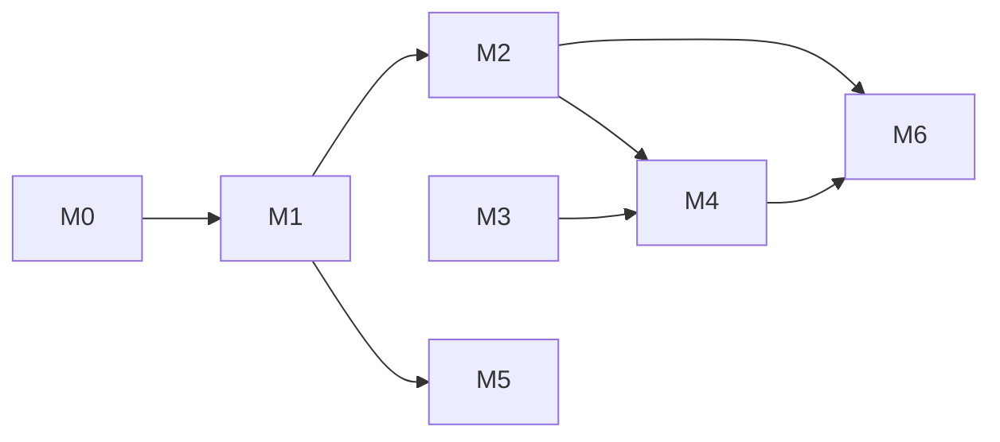

# Work breakdown

Work is split into four workstreams, each run as its own thread with its own branches and pull requests.
Milestones define the order; a workstream only starts a milestone item when its dependencies are merged.

## Milestones

| # | Milestone | Done when |
|---|---|---|
| M0 | **Foundation** | Turborepo + pnpm scaffold, shared configs, `docker compose up` brings up postgres, redis, chroma, langflow and an `api` that answers `/health` and serves `/docs`. CI runs lint, typecheck and tests on every PR |
| M1 | **Ingestion (documents)** | PDF, DOCX, TXT and MD go from upload or `pnpm ingest` to searchable chunks in Chroma, with per-stage progress events |
| M2 | **Query** | `/v1/search` and `/v1/query` return answers with citations through the versioned Langflow flow; API keys enforced |
| M3 | **Design approved** | Mocks for every admin screen reviewed and approved by Guilherme. **Frontend build does not start before this** |
| M4 | **Admin UI** | Drag-and-drop upload, live progress, document library, query playground, API keys, all against the real API |
| M5 | **Video** | `video` compose profile: upload mp4/mp3/wav, transcript via Whisper, timestamped citations |
| M6 | **Hardening** | Retrieval eval in CI, compose smoke test in CI, docs complete (ingestion guide, API guide, ops), MCP server for agents |

Design (M3) runs in parallel with M0 to M2, so mocks are ready to approve by the time the API exists.

## Workstream 1: Backend

Owns `apps/api`, `apps/worker`, `packages/*` (except `config` tooling shared with testing), `flows/`, `docker/`, `docker-compose.yml`.

1. **M0 scaffold** (first PR, unblocks everyone): Turborepo + pnpm, `packages/config`, `packages/shared`, `apps/api` with Fastify, zod type provider, Swagger UI at `/docs`, `/health` and `/ready`; `docker-compose.yml` with postgres, redis, chroma, langflow (pinned versions, healthchecks, named volumes); `.env.example`; minimal CI workflow (install, lint, typecheck, test, build).
2. `packages/db`: Drizzle schema and migrations for `documents`, `jobs`, `job_events`, `api_keys`; migrations run on api start.
3. `packages/ingestion-core`: parsers (pdf via unpdf, docx via mammoth, md, txt), normaliser, heading-aware chunker, embedder adapter for OpenAI-compatible APIs (LM Studio by default, hosted providers via env), Chroma writer. Pure functions where possible so they are unit-testable.
4. `apps/worker`: BullMQ consumer, stage-by-stage progress events to redis, retries, idempotent re-index.
5. Upload and documents endpoints, job endpoints, SSE `/v1/jobs/events`.
6. `packages/cli`: `pnpm ingest <folder> --course X`, `pnpm parse <file>` (dry run), `pnpm reindex`.
7. Langflow: build the RAG query flow, export to `flows/rag-query.json`, auto-load on startup; `packages/langflow-client`; `/v1/search` and `/v1/query` (with streaming) and citation shaping.
8. API key auth with `read` and `admin` scopes.
9. M5: whisper compose profile, ffmpeg extraction, transcript to timestamped chunks.
10. M6: `apps/mcp` exposing `search_materials` and `ask_materials`.
11. Docs: `docs/ingestion.md` (supported formats, how to add a parser, CLI usage), `docs/api.md` (auth, examples with curl), `docs/operations.md` (env vars, providers, backups).

## Workstream 2: Frontend

Owns `apps/admin`. **Starts building only after M3 (design approved).** Before that it may only agree the API contract with backend via `packages/shared`.

1. Vite + React + TypeScript app, Tailwind, shadcn/ui, TanStack Query, React Router; typed API client generated from `/openapi.json` (openapi-typescript) so UI and API never drift.
2. Layout shell from the approved mocks (sidebar, top bar, light/dark theme).
3. Upload screen: react-dropzone multi-file drag and drop, course selector, per-file upload progress, then hand-off to ingestion progress.
4. Ingestion progress: live job list fed by SSE, per-stage progress (parse, chunk, embed, index), errors with retry.
5. Document library: table with filters (course, type, status), detail drawer with chunks preview, delete and re-index.
6. Query playground: ask a question, streamed answer, clickable citations (page or timestamp), course filter, raw search mode.
7. Settings: API keys (create, revoke, copy once), provider and model info read from `/ready`.
8. Served by nginx in the `web` container, proxying `/api` to `api`.

## Workstream 3: Testing and validation

Owns `tests/`, CI workflows, and test presets in `packages/config`. Works alongside each backend and frontend PR rather than after it.

1. Test strategy doc (`docs/testing.md`): what each layer covers, how to run locally.
2. Vitest presets for packages and apps; coverage thresholds on `ingestion-core` and `api`.
3. Fixture corpus in `tests/fixtures/`: small PDF (with multiple pages and a table), DOCX with headings, MD with front matter, TXT, a broken PDF, a short audio clip.
4. Parser and chunker unit tests (golden snapshots of chunk output per fixture).
5. API integration tests with Testcontainers (postgres, redis, chroma); Langflow stubbed with MSW at the HTTP boundary.
6. Contract test: generated OpenAPI is valid and matches a committed snapshot; breaking changes fail CI.
7. Compose smoke test in CI: `docker compose up`, ingest fixtures, query, assert a citation comes back. Uses a stub OpenAI-compatible server (fake embeddings and chat) in place of LM Studio, so it is deterministic, free, and needs no GPU.
8. Playwright e2e for the admin UI (upload, progress, query) once M4 lands.
9. Retrieval evaluation: `tests/eval/questions.yaml` with expected source documents; report recall@k and MRR; run nightly and on demand, warn on regressions.
10. GitHub Actions layout: `ci.yml` (lint, typecheck, unit, integration, build) on every PR with Turborepo caching; `e2e.yml` (compose smoke + Playwright) on PRs touching apps; `eval.yml` nightly.

## Workstream 4: Design

Owns the visual design and mocks. Delivers mocks for review before frontend builds anything.

1. Visual direction: modern, clean, shadcn/ui-based look; colour tokens, typography, spacing, light and dark themes, mapped to Tailwind config so frontend can use them directly.
2. Mocks for each screen, in both themes where it matters:
   - Dashboard / overview (counts by course, recent jobs, system health)
   - Upload with drag-and-drop (empty, dragging, uploading, done, error states)
   - Ingestion progress (job list, per-stage progress, failure state)
   - Document library and document detail with chunk preview
   - Query playground (question, streamed answer, citations panel)
   - Settings and API keys
   - Empty states and first-run onboarding ("no material yet")
3. A short clickable prototype of the main flow: drop files, watch progress, ask a question.
4. Component inventory: which shadcn/ui components each screen uses, and any custom ones.
5. Review with Guilherme; iterate until approved. Approval closes M3 and unblocks frontend.

## Starting order for the threads

1. **Backend** starts now with the M0 scaffold PR, since every other stream builds on it.
2. **Design** starts now, in parallel; it does not depend on code.
3. **Testing and validation** starts once the M0 scaffold PR is open, by adding the test presets, fixture corpus and CI layout onto it.
4. **Frontend** waits for design approval (M3) and the M1 API contract.
