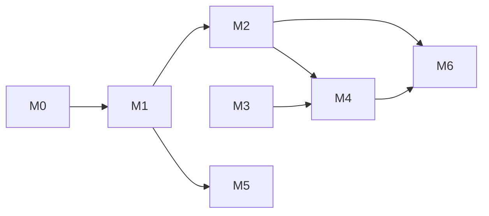

# Work breakdown

Work is split into four workstreams, each run as its own thread with its own branches and pull requests.
Milestones define the order; a workstream only starts a milestone item when its dependencies are merged.

## Milestones

| # | Milestone | Done when |
|---|---|---|
| M0 | **Foundation** | Turborepo + pnpm scaffold, shared configs, `docker compose up` brings up postgres, redis, chroma, langflow, keycloak (realm imported) and an `api` that answers `/health` and serves `/docs`. CI runs lint, typecheck and tests on every PR |
| M1 | **Workspaces and ingestion** | Workspaces CRUD with isolated Chroma collections; PDF, DOCX, TXT and MD go from upload through the Langflow ingest flow to searchable passages, with live per-file status |
| M2 | **Asking, auth, analytics** | Passages, answers and conversations through the Langflow flows; Keycloak login and workspace-scoped API keys enforced; every request logged for analytics |
| M3 | **Design approved** | Mocks for every admin screen reviewed and approved by Guilherme. **Frontend build does not start before this** |
| M4 | **Admin UI** | Keycloak login, workspace switcher and management, drag-and-drop upload, live status, document library, ask and chat playground, usage analytics, API keys, all against the real API |
| M5 | **Video** | `video` compose profile: upload mp4/mp3/wav, transcript via Whisper, timestamped citations |
| M6 | **Hardening** | Retrieval eval in CI, compose smoke test in CI, docs complete (ingestion guide, API guide, ops), MCP server for agents |
| M7 | **Assignment deliverables** | Flow JSON in `flows/`, setup docs, 3 to 5 page report, 3 to 5 minute demo video |

Design (M3) runs in parallel with M0 to M2, so mocks are ready to approve by the time the API exists.

## Workstream 1: Backend

Owns `apps/api`, `packages/*` (except test presets), `flows/`, `docker/`, `docker-compose.yml`.

1. **M0 scaffold** (first PR, unblocks everyone): Turborepo + pnpm, `packages/config`, `packages/shared`, `apps/api` with Fastify, zod type provider, Swagger UI at `/docs`, `/health`, `/ready`; compose with postgres, redis, chroma, langflow, keycloak (pinned, healthchecks, named volumes, `host.docker.internal` for LM Studio); `.env.example`; CI workflow (install, lint, typecheck, test, build).
2. `packages/db`: Drizzle schema and migrations for `workspaces`, `workspace_members`, `folders`, `documents`, `answers`, `answer_feedback`, `conversations`, `messages`, `api_keys`, `api_key_workspaces`, `api_requests`.
3. Auth: Keycloak realm export (`docker/keycloak/realm.json`: clients `admin-ui` and `api`, roles `admin` and `member`, seeded admin from `.env`); JWT verification via JWKS; API key lookup; workspace access checks as one Fastify hook.
4. Workspaces: CRUD, settings with defaults, Chroma collection create/delete, members, reindex.
5. Langflow: build `flows/ingest.json`, `flows/answer.json`, `flows/chat.json`, all parameterised by workspace (collection, models, prompt, chunking); import on startup; `packages/langflow-client`; Langflow API key setup (method pending decision).
6. Ingestion bookkeeping: uploads to `/data/uploads/<slug>/`, sha256 dedupe, BullMQ queue, run ingest flow per file, statuses, retries, delete and reindex by document id, SSE events.
7. Asking: passages, answers (with streaming), conversations and messages, feedback, citation shaping.
8. Usage analytics: `onResponse` hook writing `api_requests` (workspace, user or key, route, status, latency, tokens, question, cited documents); summary, timeseries, top-questions, top-documents, requests endpoints.
9. API keys: admin-only CRUD, workspace binding, `purpose: langflow` setup text.
10. M5: Whisper profile, ffmpeg extraction, timestamped transcript fed to the ingest flow.
11. Docs: `docs/setup.md` (quick start, LM Studio, Keycloak first login), `docs/ingestion.md`, `docs/api.md` (auth, examples), `docs/operations.md`.

## Workstream 2: Frontend

Owns `apps/admin`. **Starts building only after M3 (design approved).**

1. Vite + React + TypeScript, Tailwind, shadcn/ui, TanStack Query, React Router; API client generated from `/openapi.json`.
2. Keycloak login (oidc-client-ts), session handling, role-aware navigation.
3. Workspace switcher and workspace management (create, settings, members, delete, reindex).
4. Upload: drag and drop into a workspace and folder, per-file upload progress, then live status (queued, transcribing, processing, ready, failed) with retry.
5. Document library: folders, filters, detail with passages preview, delete, reindex.
6. Playground: Ask, Chat and Search modes against the current workspace, streamed answers, clickable citations, feedback buttons.
7. Usage page: requests over time, by route, workspace, key and user; latency; error rate; top questions; most cited documents; feedback.
8. API keys (admin): create with workspaces and role, copy-once secret, Langflow setup snippet, revoke.

## Workstream 3: Testing and validation

Owns `tests/`, CI workflows, test presets in `packages/config`.

1. `docs/testing.md`: what each layer covers and how to run it.
2. Vitest presets; coverage thresholds on `apps/api`.
3. Fixture corpus: multi-page PDF, DOCX with headings, MD, TXT, a broken PDF, a short audio clip.
4. **Isolation tests**: a key or user for workspace A gets 404 on every route of workspace B; passages never cross collections.
5. Auth tests: valid and expired JWTs (test signing key standing in for Keycloak), revoked and wrong-workspace API keys, admin-only routes.
6. API integration tests with Testcontainers (postgres, redis, chroma); Langflow stubbed at the HTTP boundary with MSW.
7. Contract test: the generated OpenAPI is valid and matches a committed snapshot.
8. Compose smoke test in CI: full stack with a stub OpenAI-compatible model server; create a workspace, upload fixtures, wait for ready, search, answer, chat, check usage recorded.
9. Playwright e2e for login, upload, playground once M4 lands.
10. Retrieval evaluation: golden questions per workspace, recall@k and MRR, nightly.

## Workstream 4: Design

Delivers mocks for review before frontend builds anything.

1. Visual direction and Tailwind tokens, light and dark.
2. Mocks:
   - Sign in (Keycloak theme matching the app) and first-run state
   - Workspace switcher, workspace list and create/settings screens
   - Dashboard for a workspace (documents, recent activity, health)
   - Upload with drag and drop, and live per-file status
   - Document library and document detail with passages
   - Playground with Ask, Chat and Search modes, citations, feedback
   - Usage analytics (global and per workspace)
   - API keys: list, create with workspaces and role, copy-once secret, Langflow setup
   - Empty states
3. Clickable prototype: create workspace, drop files, watch status, ask a question.
4. Review with Guilherme; approval closes M3.

## Starting order for the threads

1. **Backend** starts with the M0 scaffold PR.
2. **Design** starts now, in parallel.
3. **Testing and validation** starts once the scaffold PR is open.
4. **Frontend** waits for design approval (M3).

## Assignment deliverables (COS512, Option 4)

| Deliverable | Where it comes from |
|---|---|
| Source code incl. Langflow JSON | This repo; flows in `flows/ingest.json`, `flows/answer.json`, `flows/chat.json` |
| Setup documentation | `README.md`, `docs/setup.md`, `docs/ingestion.md`, `docs/api.md`, `docs/operations.md` |
| Tested, interactive system | CI (workstream 3), admin UI (workstream 2), Swagger UI at `/docs` |
| 3 to 5 page report | Written at M7 from `docs/architecture.md` and `docs/decisions.md`, including the TypeScript-instead-of-Python rationale |
| 3 to 5 minute demo video | Recorded at M7: sign in, create the `ouc` workspace, upload files, watch ingestion, ask and chat, search via Swagger with an API key, show usage analytics |
