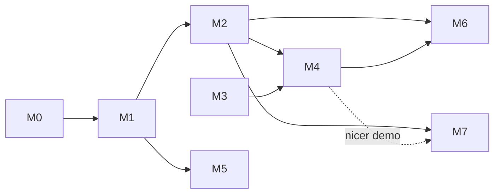

# Work breakdown

Work is split into four workstreams, each run as its own thread with its own branches and pull requests.
Milestones define the order; a workstream only starts a milestone item when its dependencies are merged.

## Milestones

| # | Milestone | Done when |
|---|---|---|
| M0 | **Foundation and Langflow spike** | Turborepo + pnpm scaffold, shared configs, `docker compose up` brings up postgres, redis, chroma, langflow, keycloak (realm imported) and an `api` that answers `/health` and serves `/docs`. CI runs lint, typecheck and tests on every PR. The [Langflow spike](#m0-spike-prove-the-langflow-contract) has passed and its findings are written into the docs |
| M1 | **Workspaces and ingestion** | Workspaces CRUD with isolated Chroma collections; PDF, DOCX, TXT and MD go from upload through the Langflow ingest flow to searchable passages, with live per-file status. The compose smoke test runs this path in CI |
| M2 | **Asking, auth, analytics** | Passages, answers and conversations through the Langflow flows; Keycloak login and workspace-scoped API keys enforced; every request logged for analytics; smoke test extended to ask, chat and usage; `docs/setup.md` and `docs/api.md` written. **The assignment's graded parts are all present from here** |
| M3 | **Design approved** | Mocks for every admin screen reviewed and approved by Guilherme. **Frontend build does not start before this** |
| M4 | **Admin UI** | Keycloak login, workspace switcher and management, drag-and-drop upload, live status, document library, ask and chat playground, usage analytics, API keys, all against the real API |
| M5 | **Video** | `video` compose profile: upload mp4/mp3/wav, transcript via Whisper, timestamped citations |
| M6 | **Hardening** | Retrieval evaluation run and written up, backup and restore tested, `pnpm doctor`, rate limits and upload limits tested, docs complete (ingestion guide, operations) |
| M7 | **Assignment deliverables** | Flow JSON in `flows/`, setup docs, 3 to 5 page report, 3 to 5 minute demo video. Can start as soon as M2 is done; M4 only makes the video nicer |
| Later | **MCP server for agents** | Optional. Agents can already use the REST API through its OpenAPI spec, so this is a convenience and not part of the core plan |

### The assignment cut line

Everything the brief grades exists at the end of M2: the API with ask, chat and retrieve equivalents, usage analytics, Langflow flows as JSON, tests in CI, setup docs, and Swagger UI as the interactive front. M3 to M6 make it a better product but are not needed to hand in. The whole plan is being built in one go (the weekend of 21 November 2026), so this is a safety net and not a schedule: the report is drafted alongside M1 and M2, and if anything later slips, the hand-in does not depend on it.

### M0 spike: prove the Langflow contract

The plan rests on things Langflow has to do that nobody has tried yet. Before any bookkeeping code is written, a throwaway script against the pinned Langflow image answers each of these, and the result goes into `flows/README.md`:

| Question | If the answer is no |
|---|---|
| Can flows be imported at startup with auto-login off? (Langflow's load-from-folder setting may need auto-login) | The API uploads the flows through Langflow's API on start |
| Can the API get a Langflow API key by signing in as the superuser? | Fall back to `LANGFLOW_API_KEY` in `.env` |
| Can a flow be run by endpoint name with tweaks for collection, models, prompt, chunking and a metadata filter? | Add a small custom component that takes them as inputs |
| Does the retrieve output carry passage ids, scores and metadata as data, not as text? | Custom output component |
| Can ingestion keep page numbers and chunk indexes? | Custom loader and splitter component |
| Does token streaming work through the run API, and do we get token counts? | Stream from the API in chunks; token counts become `null` or estimated |
| Can vectors be deleted and metadata updated by `document_id` from the API with the Chroma client? | Keep folder out of Chroma and filter by document ids |
| How long does one 50-page PDF take to ingest on LM Studio? | Sets the timeout and the upload expectations in the UI |

If several of these need custom components, that is fine and expected; if the run API cannot return structured passages at all, the plan comes back to Guilherme before M1 starts.

Design (M3) runs in parallel with M0 to M2, so mocks are ready to approve by the time the API exists.

## Workstream 1: Backend

Owns `apps/api`, `packages/*` (except test presets), `flows/`, `docker/`, `docker-compose.yml`.

1. **M0 scaffold** (first PR, unblocks everyone): Turborepo + pnpm, `packages/config`, `packages/shared`, `apps/api` with Fastify, zod type provider, Swagger UI at `/docs`, `/health`, `/ready`; compose with postgres, redis, chroma, langflow, keycloak (pinned, healthchecks, named volumes, `host.docker.internal` for LM Studio); `.env.example`; CI workflow (install, lint, typecheck, test, build).
2. **Langflow spike** (see above), in parallel with the scaffold.
3. `packages/db`: Drizzle schema and migrations for `workspaces`, `workspace_members` (keyed by Keycloak user id), `folders`, `documents`, `answers`, `answer_feedback`, `conversations`, `messages`, `api_keys`, `api_key_workspaces`, `api_requests`. Unique `(workspace_id, sha256)` on documents; indexes on `api_requests` by time, workspace and key.
4. Auth: Keycloak realm export (`docker/keycloak/realm.json`: clients `admin-ui` and `api`, role `admin`, seeded admin from `.env`, fixed public hostname); JWT verification via JWKS with the internal and public URLs kept apart; API key lookup by `rw_` prefix and SHA-256 hash; workspace access checks as one Fastify hook; rate limiting; read-only user list from Keycloak.
5. Workspaces: CRUD, settings with defaults (embedding model pinned at creation), Chroma collection create/delete, members, reindex with the `reindexing` state.
6. Langflow: build `flows/ingest.json`, `flows/retrieve.json`, `flows/answer.json`, `flows/chat.json`, all parameterised by workspace (collection, models, prompt, chunking) and run by endpoint name; `flows/README.md` with the contract; `pnpm flows:export` and `flows:import`; import on startup; `packages/langflow-client`; Langflow API key setup (method pending decision).
7. Ingestion bookkeeping: uploads to `/data/uploads/<slug>/`, size and type limits, sha256 dedupe, BullMQ queue, run ingest flow per file with a timeout, clean-before-retry, statuses, retries with backoff, recovery of stuck documents on start, delete and reindex by document id, SSE events with a snapshot on connect.
8. Asking: passages, answers (with streaming), conversations and messages, feedback, citation shaping, the "not found" answer when nothing scores high enough.
9. Usage analytics: `onResponse` hook writing `api_requests` (workspace, user or key, route, status, latency, time to first token, tokens when known, question, cited documents); summary, timeseries, top-questions, top-documents, requests endpoints; question retention job.
10. API keys: admin-only CRUD, workspace binding, expiry, last used, `purpose: langflow` setup text.
11. Operations: `GET /v1/system`, structured logs with request id passed to Langflow, `pnpm backup` / `restore` / `doctor`, start-up check that refuses placeholder secrets.
12. M5: Whisper profile (the ASR service takes video directly, so the API needs no ffmpeg), timestamped transcript stored and fed to the ingest flow in segments so citations carry start seconds.
13. Docs: `docs/setup.md` (quick start, LM Studio, Keycloak first login, hosted provider, minimum hardware) and `docs/api.md` (auth, examples) by M2; `docs/ingestion.md` and `docs/operations.md` (backup, upgrade, Langflow version bumps, retention) by M6.

## Workstream 2: Frontend

Owns `apps/admin`. **Starts building only after M3 (design approved).**

1. Vite + React + TypeScript, Tailwind, shadcn/ui, TanStack Query, React Router; API client generated from the committed OpenAPI snapshot (the same file the contract test guards), so the UI and the API cannot drift.
2. Keycloak login (oidc-client-ts), session handling, role-aware navigation.
3. Workspace switcher and workspace management (create, settings, members, delete, reindex).
4. Upload: drag and drop into a workspace and folder, per-file upload progress, then live status (queued, transcribing, processing, ready, failed) with retry.
5. Document library: folders, filters, detail with passages preview, delete, reindex.
6. Playground: Ask, Chat and Search modes against the current workspace, streamed answers, clickable citations, feedback buttons.
7. Usage page: requests over time, by route, workspace, key and user; latency; error rate; top questions; most cited documents; feedback.
8. API keys (admin): create with workspaces and role, copy-once secret, Langflow setup snippet, revoke.
9. System status: a banner when the model provider, Langflow or Chroma is down (most often LM Studio not running), with what to do about it.

## Workstream 3: Testing and validation

Owns `tests/`, CI workflows, test presets in `packages/config`.

1. `docs/testing.md`: what each layer covers and how to run it.
2. Vitest presets; coverage thresholds on `apps/api`.
3. Fixture corpus: multi-page PDF, DOCX with headings, MD, TXT, a broken PDF, a short audio clip.
4. **Isolation tests**: a key or user for workspace A gets 404 on every route of workspace B; passages never cross collections. The route list is read from the OpenAPI spec, so a new route cannot be forgotten.
5. Auth tests: valid and expired JWTs (test signing key standing in for Keycloak), revoked and wrong-workspace API keys, admin-only routes.
6. API integration tests with Testcontainers (postgres, redis, chroma); Langflow stubbed at the HTTP boundary with MSW. The stub's responses are recorded from the real flows during the smoke test, so the stub cannot drift from what Langflow returns.
7. Ingestion failure tests: retry does not duplicate vectors, a timed-out flow ends as `failed`, documents stuck in `processing` are requeued on start, an identical re-upload is reported as a duplicate, oversized and wrong-type files are rejected.
8. Contract tests: the generated OpenAPI is valid and matches a committed snapshot; every committed flow has the component names listed in `flows/README.md`.
9. **Compose smoke test, from M1 and extended each milestone.** The real flows are only exercised here, so it cannot wait for the end. Full stack with a stub OpenAI-compatible model server (deterministic embeddings of a fixed size, canned chat replies); real Keycloak login; create a workspace, upload fixtures, wait for ready, search, answer, chat, check usage recorded. Runs on pull requests that touch `flows/`, `docker/` or `apps/api`, and nightly on `main`, because the Langflow and Keycloak images make it slow.
10. Playwright e2e for login, upload, playground once M4 lands.
11. Retrieval evaluation: golden questions per workspace, recall@k and MRR, plus a few questions the material cannot answer to check the "not found" behaviour. It needs real models, so it runs locally against LM Studio with `pnpm eval` and its results table is committed; CI with the stub model cannot measure this. The results go into the report.
12. Backup and restore round trip, run once per release by hand and described in `docs/operations.md`.

## Workstream 4: Design

Delivers mocks for review before frontend builds anything.

1. Visual direction and Tailwind tokens, light and dark.
2. Mocks:
   - Sign in (Keycloak theme matching the app) and first-run state
   - Workspace switcher, workspace list and create/settings screens
   - Dashboard for a workspace (documents, recent activity, health)
   - Upload with drag and drop, and live per-file status
   - Document library and document detail with passages
   - Playground with Ask, Chat and Search modes, citations, feedback
   - Usage analytics (global and per workspace)
   - API keys: list, create with workspaces and role, copy-once secret, Langflow setup
   - Workspace members: people with access, grant and remove, role
   - Empty states, error states (LM Studio not running, ingestion failed with reason, workspace reindexing), and the delete-workspace confirmation
3. Clickable prototype: create workspace, drop files, watch status, ask a question.
4. Review with Guilherme; approval closes M3.

## Starting order for the threads

1. **Backend** starts with the M0 scaffold PR.
2. **Design** starts now, in parallel.
3. **Testing and validation** starts once the scaffold PR is open.
4. **Frontend** waits for design approval (M3).

## Assignment deliverables (COS512, Option 4)

| Deliverable | Where it comes from |
|---|---|
| Source code incl. Langflow JSON | This repo; flows in `flows/ingest.json`, `flows/retrieve.json`, `flows/answer.json`, `flows/chat.json` |
| Setup documentation | `README.md` (with the table mapping the brief's `/ask`, `/chat`, `/retrieve` to our routes, so a marker finds them at once), `docs/setup.md`, `docs/ingestion.md`, `docs/api.md`, `docs/operations.md` |
| Tested, interactive system | CI (workstream 3), admin UI (workstream 2), Swagger UI at `/docs` |
| 3 to 5 page report | Drafted alongside M1 and M2, finished at M7, from `docs/architecture.md` and `docs/decisions.md`: the TypeScript-instead-of-Python rationale, the route mapping, and the retrieval evaluation results |
| 3 to 5 minute demo video | Recorded at M7: sign in, create the `ouc` workspace, upload files, watch ingestion, ask and chat, search via Swagger with an API key, show usage analytics |
